# Mjera (PVC Quote Engine): complete project documentation

> **What this file is.** One document that explains the whole project: the business it serves, the calculation engine, the code, the design, the database, security and the current state. A developer who has never opened the repository should be able to understand the project from this file alone.
>
> **Snapshot.** Written on 15 November 2026 from the source code on branch `feat/m8-frontend` (latest commit `99eeb86`). The worked examples were produced by running the real engine (`services/demo_catalogue.calculate`) on the demo catalogue; they are not hand-made. If this file and the code ever disagree, the code is right and this file is out of date.
>
> **Secrets.** No password, key or token appears in this file. Where a file in the repository holds one (the local development database password in `compose.yaml`), the file is named and the value is left out.

### Status tags used throughout

| Tag | Meaning |
|---|---|
| **Built** | Implemented, and its automated tests run and pass on the development machine. |
| **Built, unverified** | Implemented and covered by tests, but those tests have never run, because they need PostgreSQL and Docker has not started on the development machine. |
| **Written, never run** | Server and GitHub files that cannot run until there is a server and a GitHub repository. |
| **Planned** | Described in `docs/PLAN.md`, not built. |
| **Owner input** | Waits for real data or a decision from Mirza (the developer) or the workshop owner. |

All paths are relative to the repository root. Backend Python paths are given from `backend/src/quote_engine/` when it is obvious (for example `engine/pricing.py` means `backend/src/quote_engine/engine/pricing.py`).

---

## Contents

0. [The project on one page](#0-the-project-on-one-page)
1. [Product idea](#1-product-idea)
2. [Technologies](#2-technologies)
3. [Architecture](#3-architecture)
4. [The calculation and pricing engine](#4-the-calculation-and-pricing-engine)
5. [Features and workflows](#5-features-and-workflows)
6. [User interface and experience](#6-user-interface-and-experience)
7. [Database](#7-database)
8. [Security](#8-security)
9. [Development status](#9-development-status)
10. [Installation and running](#10-installation-and-running)
11. [Technical assessment](#11-technical-assessment)
- [Appendix A: Glossary (English, Bosnian, code)](#appendix-a-glossary)
- [Appendix B: File index](#appendix-b-file-index)

---

## 0. The project on one page

| | |
|---|---|
| **Name** | **Mjera** is the app's working name (from the Bosnian *po mjeri*, "made to measure"; not yet confirmed). The repository and Python package are called PVC Quote Engine / `quote_engine`. |
| **For whom** | One small PVC window workshop in Kosovo (the README names Mitrovica). Its owner uses it on a phone on building sites and at a PC in the workshop. |
| **What it does** | From three width and three height readings of a wall opening it works out the window size, cuts every profile piece with its formula, packs the pieces onto as few 6 m stock bars as possible, prices the job layer by layer in whole cents, and manages the quote (revisions, statuses, payments). |
| **Core principle** | *Every number explains itself.* Every cut length carries its formula (`W + 2a = 810 + 6 = 816`), every price is a sum of named layers, and a missing catalogue value or price stops the calculation with a clear message instead of being guessed. |
| **Stack** | Python 3.13, FastAPI, SQLAlchemy 2, PostgreSQL 18, OR-Tools (backend). React 19, TypeScript 6, Vite 8, Tailwind 4 (frontend). Docker, Caddy (deployment, not yet run). |
| **Size** | About 14,400 lines of Python, TypeScript and CSS in `backend/src` and `frontend/src`, plus tests. 70 commits, git is local only (no remote). |
| **State** | The engine is complete and well tested (533 backend tests pass). The database and API layer is written, but its database tests (51 test cases) have never run. The owner's screens are built and designed. Not built: PDFs, the admin catalogue screens, editing extras in the UI, deployment. **All demo prices are market estimates and all cutting deductions are invented samples**: neither is real workshop data. |

---

## 1. Product idea

### 1.1 Purpose

`PRODUCT.md` states the purpose: Mjera replaces pencil-and-paper quoting. From three width and three height readings per opening it computes the window size, cuts every piece with its formula, packs the pieces onto the fewest stock bars, prices the job layer by layer, and (planned) produces the client PDF and the workshop cutting plan.

Its stated success criteria (`PRODUCT.md`):
- the client gets a correct, explained price in minutes, on site;
- the workshop buys fewer bars and cuts with fewer mistakes;
- a price the client accepted never changes afterwards.

### 1.2 The business problem

A window workshop sells made-to-measure windows. Every quote needs the same chain of work, done by hand today:

1. **Measuring.** Wall openings are never perfectly square, so each one is measured several times, and the window must be smaller than the opening by an installation gap that depends on the size and on the colour of the profile.
2. **Cutting arithmetic.** Each window is made of 20 to 30 pieces (frame, sash, beads, steel reinforcement, mullions). Every piece length comes from the window size minus deductions printed in the profile manufacturer's catalogue ("system sheet"). A wrong deduction wastes profile and glass.
3. **Bar planning.** Profiles are bought as 6 m bars. Which pieces are cut from which bar decides how many bars are bought and how much is thrown away.
4. **Pricing.** Material comes from several suppliers whose prices change (a supplier raises prices by X%). On top come margin, labour, installation, transport, discount and VAT.
5. **Quote management.** The client may ask for changes; the quote has a validity period; once accepted, the price must stay fixed; the workshop takes a 50% advance and collects the balance.

The repository does not contain any measurement of how long quoting takes today or how much is wasted. Milestone M1 (requirements with the owner, including a "Step 0 baseline") is **Owner input** and has not been done.

### 1.3 Target users

From `PRODUCT.md`:

| User | Context | Needs |
|---|---|---|
| **The owner, on site** (primary) | On his phone, in sunlight, with dusty or wet hands, sometimes on a ladder. Comfortable with Viber and WhatsApp, little else. | Measure each opening, get a priced quote and send it before leaving. Every screen obvious without explanation. |
| **The owner at the workshop PC** | Laptop or PC. | Keep price lists current, read the cutting plan, check quotes, record payments. |
| **The admin** | The developer (Mirza). | Maintain the technical catalogue: profile systems, system sheets, hardware sets, construction types, users and sessions. Uses two-factor login (TOTP). |
| **Demo visitors** | A public demo workshop with invented data (planned to be wiped nightly). | See the product without real data. A feature, not a design audience. |

### 1.4 How PVC and aluminium windows are made (the real-world workflow)

This section explains the trade so the engine makes sense. Bosnian trade words are in brackets; they are the words the app shows (`frontend/src/lib/labels.ts`, `frontend/src/i18n/bs.json`).

**Parts of a window** (seen from inside):
- **Frame** (*štok*): the outer ring fixed into the wall opening.
- **Sash** (*krilo*): the ring that opens, holding the glass. A window has one sash per opening field.
- **Fixed T-mullion** (*stub*): a fixed vertical post inside the frame that splits it into two fields.
- **False mullion** (*štulp*): a profile fixed to one of two sashes, so two sashes close against each other without a fixed post.
- **Bead** (*lajsna*): thin strips that clip in and hold the glass.
- **Steel reinforcement** (*armatura*): galvanised steel inside the chambers of PVC profiles for stiffness. Aluminium needs none.
- **Gasket** (*dihtung*): rubber seal along the frame and sash.
- **Hardware** (*okov*): the hinge-and-lock fittings and handle. Tilt-and-turn hardware lets the sash tilt in at the top or swing open.
- **Glass unit** (*staklo*): an insulated glass unit, written like `4-16-4` (4 mm glass, 16 mm gap, 4 mm glass) or `4-12-4-12-4 Low-E Ar` (triple glazing with a low-emissivity coating and argon).
- **Extras**: interior sill (*klupčica*, priced per metre), roller shutter (*roletna*, per m²), insect screen (*komarnik*, per m²).

**The job, step by step:**

1. **Measure the opening.** Three widths (top, middle, bottom) and three heights (left, middle, right). The smallest reading counts, because the window must fit at the tightest point. Readings more than 10 mm apart are suspicious (a crooked opening or a misread tape).
2. **Window size.** Window = smallest reading minus an installation gap on both sides (room for foam and movement). The gap grows with the opening size and is larger for coloured (foiled) profiles.
3. **Choose the construction.** Type (single sash, two fields with a fixed mullion, two sashes with a false mullion, fixed glazing, balcony door), opening side of each sash, colour (white, foil outside, foil both sides), glass, quantity, installation options.
4. **Cut.** PVC profile pieces are cut from 6 m bars at 45° and their corners are welded. Welding melts a few millimetres of each end, so every welded piece is cut longer by a **weld allowance** `a` per end (`2a` per piece). Each saw cut also eats the blade width (**kerf**), and the bar ends are trimmed. Steel, beads and mullions are cut at 90°. Glass is ordered from a glass company by exact size.
5. **Aluminium** (as implemented, still to be confirmed by the owner): corners are crimped rather than welded, so there is no weld allowance, and there is no steel.
6. **Price.** Material (bars, gasket, hardware, glass, consumables), plus margin on material, plus labour, plus installation, plus transport, minus discount, plus VAT if the workshop is VAT-registered. The client pays an advance (50% by default) and the balance later.
7. **Quote lifecycle.** The quote is sent (today by Viber or WhatsApp), is valid for 15 days by default, may be revised, and is accepted or rejected. After acceptance the workshop buys material and builds.

### 1.5 How the system solves it

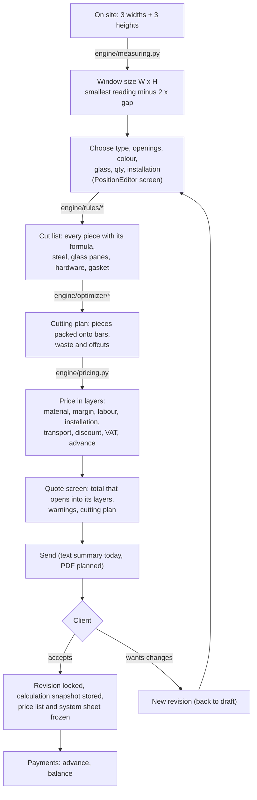

What makes it different from a spreadsheet (from `PRODUCT.md`, "Positioning"):
- Each cut piece carries its formula; each price is a sum of named layers in whole cents.
- Catalogue values are never guessed: a missing deduction or price stops the quote and names what is missing.
- Accepted quotes are frozen together with the exact system-sheet version and price-list version they used.

### 1.6 Scope

From `docs/PLAN.md` section 1, with the current state:

| v1 scope item | State |
|---|---|
| Several profile systems side by side; same window quotable in two systems | **Built** (6 demo systems; a quote picks one system) |
| Bar length per profile; prices per colour (white, foil one side, foil both sides) | **Built** |
| 5 construction types | **Built** (balcony door built like a single sash; its threshold has no rule yet) |
| Measuring: 3 + 3 readings, gap by size and colour | **Built** |
| Cut, steel, glass, hardware lists and gasket metres, each piece with its formula | **Built** |
| Optimizer: FFD + exact CP-SAT for comparison + lower bound | **Built** |
| Price layers incl. 18% VAT switch | **Built** |
| Price per m² next to a market check | Half: the engine computes `cents_per_m2` per position; the UI does not show it |
| Supplier price book with supplier, unit, date; history; "+X% from this supplier" | **Built, unverified** (API and UI) |
| Price-request message for suppliers | Engine data structure **Built** (`engine/lists.py`); message text **Planned** (M7) |
| Quote validity, price-list age warning | **Built** |
| Purchase list on acceptance | Engine **Built**; not exposed by API or UI |
| Payment tracking (advance, balance) | **Built, unverified** |
| Revisions, diff, accepted revision locked | **Built, unverified** |
| Statuses incl. computed "expired" | **Built, unverified** |
| Client PDF (Bosnian, Albanian), text summary, workshop PDF, glass order | Text summary **Built**; PDFs **Planned** (M7) |
| Hardware size and weight warnings | Engine **Built**; not wired into calculations |
| Admin screens (price lists, suppliers, systems and sheets, construction types, users, sessions) | API **Built, unverified**; UI only for price lists, suppliers' bump and settings |
| Login for 2 users, TOTP for admin | **Built, unverified** |
| Demo workshop with "DEMO" banner, wiped nightly | Seed/wipe commands and banner **Built**; nightly scheduling **Planned** |
| Shutters and screens per m², sills per metre | Engine and API **Built**; no UI to add them |

PLAN.md's "Later (v2), do not build" list includes **aluminium windows**. Aluminium was nevertheless built on 14 November 2026 at Mirza's explicit request (see `docs/PROGRESS.md`, "Aluminium, per-system prices and a live demo"). "Never" (PLAN.md): invoicing, accounting, sending cuts to the saw.

---

## 2. Technologies

### 2.1 Backend (`backend/`, managed by `uv`)

| Technology | Version (lower bound in `pyproject.toml`) | Used for | Why |
|---|---|---|---|
| Python | 3.13 | Everything on the server | Modern typing (`type` aliases, `StrEnum`); managed by `uv`, no system Python. |
| FastAPI | ≥ 0.162.4 | HTTP API, dependency injection for auth | Typed request handling and an OpenAPI schema the frontend types are generated from. |
| Pydantic | ≥ 2.14.3 | Request validation (`api/schemas.py`), every model `extra="forbid"` | Rejects unknown fields and out-of-range sizes before any logic runs. |
| SQLAlchemy | ≥ 2.1.8 | Typed ORM (`db/models.py`) | Typed mapped columns; one `Scoped` repository enforces tenancy. |
| Alembic | ≥ 1.20.1 | Migrations, kept inside the package (`quote_engine/migrations`) | Run with `python -m quote_engine.manage migrate`, so the container needs no `alembic.ini`. |
| psycopg | ≥ 3.3.9 (binary) | PostgreSQL driver | |
| PostgreSQL | 18 (Docker image) | Database | JSONB for readings, openings, snapshots. |
| argon2-cffi | ≥ 25.1.0 | Password hashing (Argon2id) | OWASP-recommended password hash. |
| pyotp | ≥ 2.10.0 | TOTP two-factor codes for the admin | |
| OR-Tools | ≥ 9.15 | CP-SAT exact optimizer (`engine/optimizer/exact.py` only) | Proves how close the fast heuristic is to the optimum. |
| uvicorn | ≥ 0.54.0 | ASGI server | |

Development tools (dependency group `dev`): pytest ≥ 9.2, pytest-cov, Hypothesis (property tests of the optimizer), mypy ≥ 2.4 in **strict** mode for the whole backend, Ruff (lint and format, including security rules `S` and "no print" `T20`), import-linter (architecture contracts), httpx (FastAPI test client), PyYAML and its type stubs (test fixtures and golden-job files), pre-commit.

WeasyPrint (PDFs, M7) is **not** a Python dependency yet; only its system libraries are installed in `infra/Dockerfile`.

### 2.2 Frontend (`frontend/`, Node ≥ 22.12)

| Technology | Version | Used for |
|---|---|---|
| React | 19.3 | UI |
| TypeScript | ~6.0.3 | Types; `tsc -b` is the type gate |
| Vite | 8.3 | Dev server (proxies `/api` to `localhost:8000`) and build; `assetsInlineLimit: 0` so no `data:` URIs break the CSP |
| Tailwind CSS | 4.3 (`@tailwindcss/vite`) | Styling with design tokens in `src/index.css` |
| TanStack Query | 5.107 | Server state, caching; no retry on 4xx (`src/main.tsx`) |
| React Hook Form + Zod | 7.92 / 4.6 | Forms and validation (client form in New quote) |
| react-router | 8.5 | Routing |
| i18next + react-i18next | 27 / 18 | Bosnian (default) and English |
| openapi-typescript | 7.13 | Generates `src/api/schema.d.ts` from `frontend/openapi.json` (`npm run gen:api`) |
| Vitest + Testing Library + jsdom | 5.1 | Unit and screen tests |
| Playwright + @axe-core/playwright | 1.65 / 4.14 | End-to-end test and accessibility scan (`e2e/owner.spec.ts`, needs the running stack) |
| ESLint 10 + typescript-eslint + react-hooks plugin | | Lint |
| Noto Sans (variable, OFL) | self-hosted woff2 in `src/assets/fonts/` | The only font; the CSP forbids external fonts |

### 2.3 Infrastructure (**Written, never run**)

| Technology | File | Role |
|---|---|---|
| Docker (multi-stage) | `infra/Dockerfile` | Stage 1 `node:24-slim` builds the frontend; stage 2 `python:3.13-slim` installs WeasyPrint's system libraries, `uv sync --locked --no-dev`, runs as non-root user (uid 10001), `HEALTHCHECK` on `/api/v1/health`, starts uvicorn with `--proxy-headers`. |
| Docker Compose | `compose.yaml` (local), `infra/compose.prod.yaml` (server) | Local: app + PostgreSQL 18, both ports bound to `127.0.0.1`. Production: Caddy + app + PostgreSQL; only Caddy publishes ports (80, 443); the app is only `expose`d internally. |
| Caddy | `infra/Caddyfile` | HTTPS with automatic certificates, compression, security headers, reverse proxy to `app:8000`. |
| Bash scripts + systemd | `infra/setup-server.sh`, `deploy.sh`, `backup.sh`, `restore.sh`, `infra/systemd/` | Server setup, deploy with migration, health check and rollback, `age`-encrypted backups to two remotes with rotation, restore drill. |
| GitHub Actions | `.github/workflows/ci.yml`, `codeql.yml`, `deploy.yml`, `.github/dependabot.yml` | CI (ran once successfully in M0), CodeQL, deploy, Dependabot. Need a GitHub repository, which does not exist now. |
| Planned hosting | `docs/runbook.md` | An Oracle Cloud "Always Free" server and a domain (Cloudflare). **Owner input.** |

---

## 3. Architecture

### 3.1 The big picture

One FastAPI process serves both the JSON API (under `/api/v1`) and the built React app, from one origin. That keeps cookies simple (`__Host-` cookies, `SameSite=Lax`) and lets the Content-Security-Policy be `default-src 'self'`.

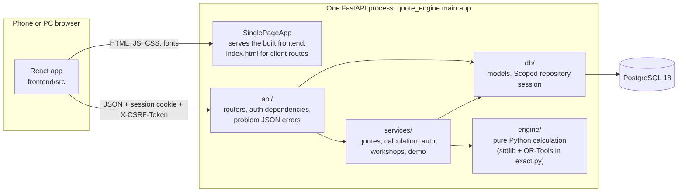

### 3.2 Backend layers and the rules between them

| Layer | Folder | Knows about | Must not know about |
|---|---|---|---|
| **Engine** | `engine/` | Only the Python standard library (and OR-Tools in `optimizer/exact.py`) | FastAPI, SQLAlchemy, Pydantic, httpx, `quote_engine.api`, `quote_engine.db` |
| **Services** | `services/` | Engine, database models | HTTP |
| **Database** | `db/`, `migrations/` | SQLAlchemy | Engine internals |
| **API** | `api/` | Services, database, Pydantic schemas, auth | Calculation details |

The engine's purity is enforced, not just intended: `pyproject.toml` defines two **import-linter** contracts that run in the local check:
1. "The engine is pure": `quote_engine.engine` may not import `fastapi`, `sqlalchemy`, `pydantic`, `httpx`, `quote_engine.api` or `quote_engine.db`.
2. "Only the exact solver may use OR-Tools": every engine module except `engine.optimizer.exact` is forbidden to import `ortools`.

A test (`tests/engine/test_purity.py`) checks the same from another angle: importing the engine must load standard-library modules only.

**Why this matters.** The engine takes plain frozen dataclasses and returns plain frozen dataclasses. It can be tested without a database or web server, run in a script, and reasoned about in isolation. The services layer is the translator: it reads rows, builds engine inputs (`services/calculation.py: position_spec, extra, price_book, pricing_settings`) and turns results back into JSON (`plain`, `plain_dict`).

### 3.3 Repository layout

```
PVC Quote Engine/
├── backend/
│   ├── pyproject.toml, uv.lock
│   ├── src/quote_engine/
│   │   ├── main.py              create_app(): routers, problem JSON, dev routes, static frontend
│   │   ├── settings.py          Settings from QUOTE_ENGINE_* environment variables
│   │   ├── manage.py            CLI: migrate, create-workshop, create-user, seed-demo, wipe-demo
│   │   ├── export_openapi.py    writes frontend/openapi.json (--check for CI)
│   │   ├── engine/              PURE calculation engine
│   │   │   ├── units.py         Mm, Mm2, Cents, Bp + every rounding helper
│   │   │   ├── errors.py        EngineError, MissingConstant, MissingPrice, InvalidInput
│   │   │   ├── model.py         SystemConstants, PositionSpec, Piece, GlassPane, CutList, enums
│   │   │   ├── sheet.py         system sheet (plain mapping) -> SystemConstants
│   │   │   ├── measuring.py     gap table, measure_opening
│   │   │   ├── rules/           registry + one module per construction type + common helpers
│   │   │   ├── optimizer/       plan, ffd, bounds, exact (CP-SAT), groups, validate
│   │   │   ├── prices.py        PriceKey, Price, PriceBook
│   │   │   ├── pricing.py       every price layer
│   │   │   ├── warnings.py      warning codes and checks
│   │   │   └── lists.py         glass order, purchase list, price request, quote summary
│   │   ├── services/            auth, quotes, calculation, workshops, demo, demo_catalogue
│   │   ├── db/                  base, models, repository (Scoped), session
│   │   ├── migrations/          env.py, versions/0001_baseline, 0002_profile_system_material
│   │   └── api/                 deps, problems, schemas, routes_* (health, auth, clients,
│   │                            quotes, admin, dev)
│   ├── tests/                   engine/, api/, golden/, property/, fixtures/, test_infra.py,
│   │                            test_benchmark.py
│   └── benchmarks/run.py        FFD vs exact vs lower bound
├── frontend/
│   ├── package.json, vite.config.ts, openapi.json (generated), playwright.config.ts
│   ├── src/
│   │   ├── main.tsx, App.tsx, index.css (design tokens)
│   │   ├── api/                 client.ts, queries.ts, schema.d.ts (generated), types.ts
│   │   ├── screens/             Login, QuotesList, NewQuote, QuoteScreen, CuttingPlan,
│   │   │                        StatusPill, Admin, position/ (PositionEditor, MeasureStep,
│   │   │                        TypeStep, DetailsStep)
│   │   ├── components/          ui.tsx, WindowDrawing.tsx, Icon.tsx
│   │   ├── lib/                 format, readings, revision, remember, labels
│   │   ├── i18n/                bs.json, en.json, index.ts
│   │   ├── dev/                 mock.ts, fixture.json (development demo only)
│   │   └── assets/fonts/        Noto Sans woff2
│   └── e2e/owner.spec.ts
├── infra/                       Dockerfile, compose.prod.yaml, Caddyfile, scripts, systemd/
├── compose.yaml                 local stack
├── .github/                     workflows (ci, codeql, deploy), dependabot
├── docs/                        PLAN.md, PROGRESS.md, optimizer.md, market-prices.md,
│                                runbook.md, security.md, privacy.md, adr/
├── reports/, research_notes/    Kosovo price research (not committed)
├── .impeccable/                 design-direction records (surface brief, design.json)
├── PRODUCT.md, DESIGN.md        product truth and the design system as built
└── README.md
```

### 3.4 One request, end to end

How `POST /api/v1/quotes/{id}/revisions/{n}/calculate` flows through the layers (from `api/routes_quotes.py` and `services/calculation.py`):

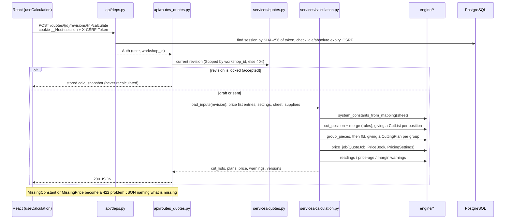

### 3.5 Frontend architecture

- **`src/main.tsx`** creates the TanStack `QueryClient` (no retry on 4xx errors) and, in development only, installs the mock when the URL has `?mock` (or `sessionStorage["mjera.mock"]` is set).
- **`src/App.tsx`** gates everything on `useMe()` (`GET /auth/me`): loading → error note → login → TOTP (admin) → the app. It shows the `DemoBanner` when the workshop `is_demo`. Routes: `/`, `/quotes/new`, `/quotes/:id`, `/quotes/:id/positions/new`, `/quotes/:id/positions/:ref`, `/admin`; anything else redirects to `/`.
- **`src/api/client.ts`** has one `request()` function: JSON in and out, the `X-CSRF-Token` header copied from the `__Host-csrf` cookie on unsafe methods, and problem JSON turned into an `ApiError`.
- **`src/api/queries.ts`** wraps every endpoint in a hook: `useMe, useLogin, useTotp, useReauth, useLogout, useQuotes, useQuote, useCalculation, useClients, useCreateClient, useSystems, useCreateQuote, useSaveRevision, useNewRevision, useSetStatus, usePayments, useAddPayment, useMeasure, usePriceLists, useSuppliers, useBump, useSettings, useSaveSettings, useUpdateSupplier`.
- **Types** come from the generated `src/api/schema.d.ts` (OpenAPI); `src/api/types.ts` types the calculation result, which the API returns as a free-form object. A backend test (`test_openapi_file_is_current`) fails if `frontend/openapi.json` is stale.
- **`src/lib/`**: `format.ts` (euros as `1.234,56 €` in Bosnian, `€1,234.56` in English; sizes `W × H`), `readings.ts` (slot order and auto-advance for the six readings), `revision.ts` (builds the revision body, next ref `P1, P2…`), `remember.ts` (last system, colour and glass in `localStorage["mjera.last"]`), `labels.ts` (engine labels into trade words).

### 3.6 The development demo (no database needed)

Because PostgreSQL could not run on the development machine, a demo path lets the real engine be used from the browser:

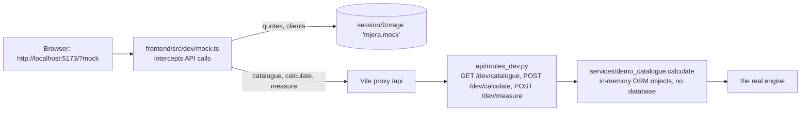

The dev routes are mounted only when `QUOTE_ENGINE_DEV_DEMO=1` **and** the environment is not `production` (`settings.py`, tested in `tests/api/test_api_offline.py::test_dev_endpoints_are_off_unless_asked_and_never_in_production`). They have no authentication and touch no database. The mock code lives in `src/dev/` and is not part of the production build path.

### 3.7 Deployment architecture (**Written, never run**)

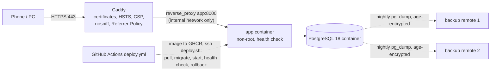

Secrets on the server live only in `/etc/quote-engine/app.env` (root-only) and, for deployment, in GitHub encrypted secrets of a `production` environment.

---

## 4. The calculation and pricing engine

This is the heart of the project. Everything in this section is **Built** and covered by tests in `backend/tests/engine/`, except where marked.

### 4.1 Ground rules: whole numbers only

The engine never uses floating point for lengths, areas, weights or money (`engine/units.py`):

| Type | Meaning | Example |
|---|---|---|
| `Mm` | length in whole millimetres | `810` |
| `Mm2` | area in whole square millimetres | `1_142_100` (= 1.1421 m²) |
| `Cents` | money in whole euro cents | `22445` (= €224.45) |
| `Bp` | percentage in basis points; 10,000 = 100% | `2500` = 25% |

Every rounding goes through one helper, and all of them round **half up**:

| Helper | Formula (integer division `//`) | Example from the worked job |
|---|---|---|
| `pct(amount, bp)` | `(amount × bp + 5000) // 10000` | `pct(12276, 2500) = 3069` (25% margin) |
| `divide_half_up(amount, parts)` | `(amount + parts // 2) // parts` | `divide_half_up(10001, 2) = 5001` |
| `whole_metres_up(mm)` | `ceil(mm / 1000)` | `9139 mm → 10 m` |
| `per_metre(length_mm, cents_per_m)` | `(length × cents_per_m + 500) // 1000` | `per_metre(9139, 40) = 366` |
| `per_m2(area_mm2, cents_per_m2)` | `(area × rate + 500000) // 1000000` | `per_m2(866484, 1800) = 1560` |
| `rate_per_m2(amount, area_mm2)` | `(amount × 1000000 + area // 2) // area` | `rate_per_m2(19845, 1142100) = 17376` (€173.76/m²) |
| `share_bp(part, whole)` | `(part × 10000 + whole // 2) // whole` (0 if whole is 0) | waste share of a plan |
| `grams_for_area(area, g_per_m2)` | `(area × g + 500000) // 1000000` | glass weight (warnings) |
| `grams_for_length(length, g_per_m)` | `(length × g + 500) // 1000` | profile weight (warnings) |

**Errors** (`engine/errors.py`): `MissingConstant` (a catalogue value is not in the system sheet), `MissingPrice` (no price for a key), `InvalidInput` (bad input, for example a zero size). The engine never substitutes a default.

### 4.2 The pipeline

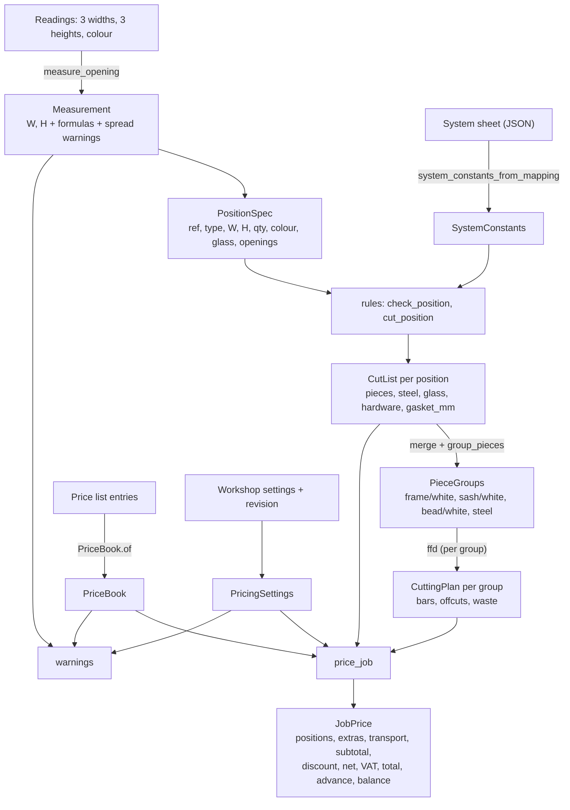

In code, the orchestration is `services/calculation.py: calculate(revision, inputs, today)`, which calls `cut_revision` (sheet → constants → `cut_position` per position → `merge` → `group_pieces`), then `ffd` per group, `plan_stats`, `price_job`, and the warnings. It returns:

```
{ "cut_lists": {...}, "plans": {group: {"plan": ..., "stats": ...}},
  "price": {...}, "warnings": [...], "versions": {"system_sheet": ..., "price_list": ...} }
```

### 4.3 Step 1: measuring (`engine/measuring.py`)

**Installation gap table** (`GAP_TABLE`), per side, looked up by the **smallest** reading of that dimension:

| Opening (smallest reading) up to | Gap per side, white | Gap per side, coloured (any foil) |
|---|---|---|
| 1,500 mm | 10 mm | 15 mm |
| 2,500 mm | 15 mm | 20 mm |
| 3,500 mm | 20 mm | 25 mm |
| above 3,500 mm | `InvalidInput` | `InvalidInput` |

A reading exactly on a limit belongs to the smaller row ("up to" includes the limit).

**Formula** (`measure_opening(widths, heights, colour)`):

```
opening_width  = min(widths)
width_mm       = opening_width  − 2 × gap(opening_width,  colour)
opening_height = min(heights)
height_mm      = opening_height − 2 × gap(opening_height, colour)
```

**Spread warning:** if the readings of one dimension differ by more than 10 mm (`SPREAD_WARNING_ABOVE_MM = 10`), a `SpreadWarning` is returned; it becomes the `readings_spread` quote warning.

**Example (real engine output):** widths 832 / 830 / 831, heights 1432 / 1430 / 1445, white:

```
W = opening - 2 x gap = 830 - 20 = 810
H = opening - 2 x gap = 1430 - 20 = 1410
warning: height readings differ by 15 mm (more than 10)
```

The same opening in a foiled colour would get 15 mm per side: 830 − 30 = 800.

The frontend accepts readings from 300 to 4,000 mm (`lib/readings.ts`, and `api/schemas.py`); the window size itself must be 300 to 3,500 mm. The owner may also skip measuring and type the size directly ("Upiši veličinu").

The gap table follows the PVC rules in the project's window-rules notes. Whether aluminium uses the same gaps is **Owner input**.

### 4.4 Step 2: the system sheet (`engine/sheet.py`, `engine/model.py`)

A **system sheet** is the catalogue data of one profile system (for example "REHAU Euro-Design 70"). It is stored as JSON in `system_sheet_versions.constants` and read by `system_constants_from_mapping(data)` into a frozen `SystemConstants`. Every key is required, unknown keys are refused, and a missing value raises `MissingConstant`. `SystemConstants` has **no default values** on purpose.

| Field | Meaning | Demo value (PVC / aluminium) |
|---|---|---|
| `system_id` | the profile system key | `rehau-euro-design-70` |
| `material` | `pvc` or `aluminium` (must match the profile system row) | |
| `reinforced` | whether steel reinforcement is cut | PVC `true`, aluminium `false` |
| `bar_length_mm` | stock bar length per role (frame, sash, mullion, false_mullion, bead, threshold, steel) | 6000 each |
| `weld_allowance_mm` (`a`) | extra length per welded end | PVC 3, aluminium 0 |
| `kerf_mm` | saw blade width, per cut | 4 |
| `bar_end_trim_mm` | trimmed off each bar | 10 |
| `steel_shortening_mm` (`s`) | steel is cut this much shorter | PVC 10, aluminium 0 |
| `min_offcut_mm` | shortest offcut worth keeping | 500 |
| `deductions` | named catalogue deductions (below) | |

**Deductions used by the rules.** The demo values are the shared **SAMPLE, NOT REAL** set in `services/demo_catalogue.py` (the same for all six demo systems). Real values must come from each manufacturer's catalogue (**Owner input**).

| Deduction | Used for | Demo value (mm) |
|---|---|---|
| `sash_width` | sash width in a single-field window | 44 |
| `sash_height` | sash height (every sash) | 44 |
| `field_sash_width` | sash width in a field next to a fixed mullion | 33 |
| `twin_sash_width` | sash width when two sashes meet at a false mullion | 22 |
| `glass_in_sash` | glass size inside a sash, both ways | 88 |
| `sash_bead_horizontal` / `sash_bead_vertical` | beads inside a sash | 86 / 120 |
| `frame_bead_horizontal` / `frame_bead_vertical` | beads in a fixed frame | 97 / 131 |
| `fixed_glass` | glass size in a fixed frame, both ways | 99 |
| `mullion` | fixed T-mullion length deduction | 77 |
| `false_mullion` | false mullion length deduction | 50 |
| `frame_steel`, `sash_steel`, `mullion_steel` | steel deductions (reinforced systems only) | 66, 55, 11 |

### 4.5 Step 3: cut rules (`engine/rules/`)

**The five construction types** (`rules/registry.py: TYPES`):

| Key | Bosnian label | Fields | Openings allowed | Rule module |
|---|---|---|---|---|
| `single_sash_tilt_turn` | Jedno krilo | 1 | opening sashes | `single_sash.py` |
| `two_field_t_mullion` | Dva polja sa stubom | 2 | opening sashes | `two_field_t_mullion.py` |
| `two_sash_false_mullion` | Dva krila sa štulpom | 2 | opening sashes | `two_sash_false_mullion.py` |
| `fixed` | Fiksni | 1 | `fixed` only | `fixed.py` |
| `balcony_door_tilt_turn` | Balkonska vrata | 1 | opening sashes | `balcony_door.py` |

Opening kinds (`model.Opening`): `fixed`, `tilt_turn_left`, `tilt_turn_right`, `turn_left`, `turn_right`. Before a rule runs, `check_position` verifies the number of fields and that a fixed window has only fixed fields and other types only opening fields. A rule's output must carry its own position ref.

**Formula notation.** `W`, `H` = window width and height; `F` = width of the field a sash sits in (`W` for one field; for two fields the left field is `W/2` rounded down and the right field is `W − W/2`, so the odd millimetre goes right); `a` = weld allowance; `s` = steel shortening. Every piece's `formula` string is built from named terms by `rules/common.py: length_from`, so the string always ends in `= <length>`.

| Piece | Formula | Angle | Qty per window |
|---|---|---|---|
| Frame top, bottom | `W + 2a` | 45° | 1 each |
| Frame left, right | `H + 2a` | 45° | 1 each |
| Sash top, bottom | `F − <width deduction> + 2a` | 45° | 1 each per sash |
| Sash left, right | `H − sash_height + 2a` | 45° | 1 each per sash |
| Sash bead horizontal | `F − <width deduction> − sash_bead_horizontal` | 90° | 2 per sash |
| Sash bead vertical | `H − sash_height − sash_bead_vertical` | 90° | 2 per sash |
| Glass in a sash | `(F − <width deduction> − glass_in_sash) × (H − sash_height − glass_in_sash)` | | 1 per sash |
| Frame steel | `W − frame_steel − s` and `H − frame_steel − s` | 90° | 2 + 2 (reinforced only) |
| Sash steel | `F − <width deduction> − sash_steel − s` and `H − sash_height − sash_steel − s` | 90° | 2 + 2 per sash (reinforced only) |
| Fixed T-mullion | `H − mullion` | 90° | 1 |
| Mullion steel | `H − mullion − mullion_steel − s` | 90° | 1 (reinforced only) |
| False mullion | `H − sash_height − false_mullion` | 90° | 1 |
| Fixed frame beads | `W − frame_bead_horizontal`, `H − frame_bead_vertical` | 90° | 2 + 2 |
| Fixed glass | `(W − fixed_glass) × (H − fixed_glass)` | | 1 |

`<width deduction>` is `sash_width` (single sash, balcony door), `field_sash_width` (two fields with a T-mullion) or `twin_sash_width` (two sashes with a false mullion).

When `weld_allowance_mm` is 0 (aluminium) the `+ 2a` term is left out of the formula entirely, for example `W = 810`. When the system is not reinforced, no steel pieces are produced.

**Gasket** (`CutList.gasket_mm`, raw length, before the 5% extra added in pricing):

```
gasket = 2 × (W + H)                       frame
       + Σ over sashes 2 × (sash_w + sash_h)  every sash
       + 2 × mullion length                (T-mullion only, both sides)
       all × qty
```

Check with the worked example: `2 × (810 + 1410) + 2 × (766 + 1366) = 4440 + 4264 = 8704 mm`.

**Hardware:** one set per opening sash (`HardwareNeed(position_ref, opening, qty)`), none for fixed fields.

**Balcony door:** built exactly like a single sash with its own labels ("door sash"); the threshold is **not** modelled (the `threshold` role exists in the model and the price list, but no rule cuts it).

**Real cut list, single sash 810 × 1410, REHAU Euro-Design 70 (demo sheet), white:**

| Piece | Length | Angle | Qty | Formula |
|---|---|---|---|---|
| frame top / bottom | 816 | 45° | 1 + 1 | `W + 2a = 810 + 6 = 816` |
| frame left / right | 1416 | 45° | 1 + 1 | `H + 2a = 1410 + 6 = 1416` |
| sash top / bottom | 772 | 45° | 1 + 1 | `W - sash_width + 2a = 810 - 44 + 6 = 772` |
| sash left / right | 1372 | 45° | 1 + 1 | `H - sash_height + 2a = 1410 - 44 + 6 = 1372` |
| sash bead horizontal | 680 | 90° | 2 | `W - sash_width - sash_bead_horizontal = 810 - 44 - 86 = 680` |
| sash bead vertical | 1246 | 90° | 2 | `H - sash_height - sash_bead_vertical = 1410 - 44 - 120 = 1246` |
| frame steel horizontal | 734 | 90° | 2 | `W - frame_steel - s = 810 - 66 - 10 = 734` |
| frame steel vertical | 1334 | 90° | 2 | `H - frame_steel - s = 1410 - 66 - 10 = 1334` |
| sash steel horizontal | 701 | 90° | 2 | `W - sash_width - sash_steel - s = 810 - 44 - 55 - 10 = 701` |
| sash steel vertical | 1301 | 90° | 2 | `H - sash_height - sash_steel - s = 1410 - 44 - 55 - 10 = 1301` |
| glass 4-16-4 | 678 × 1278 | | 1 | `810 - 44 - 88 = 678` × `1410 - 44 - 88 = 1278` |
| hardware | tilt_turn_left | | 1 set | |
| gasket (raw) | 8,704 mm | | | |

**Other types, same demo sheet (real engine output, selected pieces):**

- *Two fields with a T-mullion, 1400 × 1400:* mullion `H - mullion = 1400 - 77 = 1323` (90°); left sash top `W/2 - field_sash_width + 2a = 700 - 33 + 6 = 673`; right sash top `W - W/2 - field_sash_width + 2a = 1400 - 700 - 33 + 6 = 673`; mullion steel `H - mullion - mullion_steel - s = 1400 - 77 - 11 - 10 = 1302`; two panes of 579 × 1268; gasket 16,338 mm.
- *Two sashes with a false mullion, 1400 × 1400:* false mullion `H - sash_height - false_mullion = 1400 - 44 - 50 = 1306` (90°); sash top `W/2 - twin_sash_width + 2a = 700 - 22 + 6 = 684`; two panes of 590 × 1268; gasket 13,736 mm.
- *Fixed, 600 × 900:* frame beads `W - frame_bead_horizontal = 600 - 97 = 503` and `H - frame_bead_vertical = 900 - 131 = 769`; glass `W - fixed_glass = 600 - 99 = 501` × `H - fixed_glass = 900 - 99 = 801`; no hardware; gasket 3,000 mm.
- *Balcony door, 800 × 2200:* door sash left `H - sash_height + 2a = 2200 - 44 + 6 = 2162`; glass 668 × 2068; gasket 11,824 mm.
- *Aluminium (Alumil SMARTIA S67), single sash 810 × 1410:* frame top `W = 810`, sash top `W - sash_width = 810 - 44 = 766`; no steel.

### 4.6 Step 4: grouping and the cutting optimizer (`engine/optimizer/`)

**Grouping** (`groups.py: group_pieces`): pieces of the whole quote are grouped by **role and colour** (group names like `frame/white`, `sash/foil_one_side`), because each role is one profile and each colour is a different bar. **Steel** is one group per job (`steel`), because steel has no colour; grouping it by window colour would buy steel twice (a recorded deviation from PLAN.md 4.4). Each group is cut from the bar length the sheet gives for that role.

**Bar arithmetic** (`plan.py`):

```
usable length   = bar_length − bar_end_trim           6000 − 10 = 5990
space of piece  = length + kerf                       816 + 4 = 820
used_mm (bar)   = Σ space of its pieces
offcut_mm       = usable − used_mm
waste_mm        = bars × bar_length − Σ piece lengths
waste_bp        = share_bp(waste_mm, bars × bar_length)
kept offcuts    = offcuts ≥ min_offcut_mm (500); shorter ones are scrap
```

**First Fit Decreasing** (`ffd.py`, the algorithm quotes use): sort all pieces by size, largest first (ties by key, so the result is always the same), then put each piece into the first bar that still has room, opening a new bar when none has.

**Lower bound** (`bounds.py`): `ceil(Σ piece spaces / usable length)`; no plan can use fewer bars.

**Exact solver** (`exact.py`, OR-Tools CP-SAT): an assignment model with a boolean "piece *i* is in bar *b*" and "bar *b* is used", exactly one bar per piece, a capacity constraint per bar, and symmetry breaking (`used[b] ≥ used[b+1]`). Phase 1 minimises the number of bars; phase 2, with the bar count fixed, maximises the longest offcut (a longer leftover is more reusable). Both phases share one time limit. **It is used only by the admin comparison endpoint `POST /api/v1/admin/compare-optimizer`**, never for quotes.

**Plan checker** (`validate.py: validate_plan`): every plan is checked (every piece placed once, no bar over capacity, the right bar length). Property tests (`tests/property/test_optimizer.py`, Hypothesis) generate thousands of random orders and assert the optimizer never produces an impossible plan.

**Benchmark** (`docs/optimizer.md`, `benchmarks/run.py`, 300 random orders, 3 s limit per order):

| | Total bars | At the lower bound |
|---|---|---|
| Lower bound | 1,146 | |
| FFD | 1,181 | 265 of 300 orders |
| Exact (CP-SAT) | 1,162 | 284 of 300 orders |

FFD used the same number of bars as the exact solver on 281 of 300 orders (94%) and was never more than one bar worse. Waste: FFD 19.2%, exact 18.1%. (PLAN.md asked for 1,000 orders at 10 s; the 300-order run is a recorded deviation because the full run takes about 25 minutes on the development machine.)

**Real plan for the worked example:**

| Group | Bars | Used of 5,990 | Offcut | Waste |
|---|---|---|---|---|
| frame/white | 1 | 4,480 (1416 + 1416 + 816 + 816 + 4 × 4 kerf) | 1,510 (kept) | 25.60% |
| sash/white | 1 | 4,304 | 1,686 (kept) | 28.53% |
| bead/white | 1 | 3,868 | 2,122 (kept) | 35.80% |
| steel | 2 | 5,286 and 2,886 | 704 and 3,104 (kept) | 32.17% |

One window cannot fill a 6 m bar, so its waste is high; on a real job of several windows the pieces share bars (see the calibration in 4.12).

### 4.7 Step 5: the price book (`engine/prices.py`)

Prices enter the engine as a `PriceBook`: a map from `PriceKey(kind, ref, colour)` to `Price(amount, unit, supplier, …)`. There is exactly one price per key; asking for a missing key raises `MissingPrice`; asking with the wrong unit raises `InvalidInput`. Units (`PriceUnit`): `bar`, `m`, `m2`, `set`, `piece`, `job`, `km`. Every price needs a supplier; in the database every entry also has a `quoted_on` date.

**Every key the engine asks for:**

| Item | `kind` | `ref` | `colour` | Unit | Demo value (cents) |
|---|---|---|---|---|---|
| Profile bar | `profile` | `<system>/<role>` | white / foil_one_side / foil_both_sides | bar | Euro-Design 70 frame, white: 2160 |
| Steel bar | `steel` | `<system>` | | bar | 870 |
| Gasket | `gasket` | `<system>` | | m | 40 |
| Hardware set | `hardware` | `<material>/<opening>` | | set | pvc tilt-turn 3200, turn 2200 |
| Glass | `glass` | glass build, e.g. `4-16-4` | | m2 | 1800 |
| Consumables | `consumables` | `<material>` | | piece (per window) | pvc 250 |
| Labour | `labour` | `<material>/<type>/<size class>` | | piece | pvc standard 2000 |
| Installation | `installation` | `small` / `standard` / `large` | | piece | 2000 / 2500 / 3500 |
| Installation options | `installation` | `ral` / `old_window_removal` / `wall_repair` | | piece | 2500 / 1500 / 2000 |
| Transport | `transport` | `flat` | | job | 2000 |
| Transport distance | `transport` | `km` | | km | 30 |
| Sill | `sill` | e.g. `PVC 200 mm` | colour | m | 1600 |
| Roller shutter | `shutter` | `PVC`, `aluminij izolirani` | | m2 | 3000, 3800 |
| Insect screen | `screen` | `fiksni`, `rolo`, `plisirani` | | m2 | 2200, 3500, 4000 |

`services/calculation.py: price_book` builds the book from the `price_entries` rows of the revision's price-list version.

### 4.8 Step 6: the price layers (`engine/pricing.py`)

#### Per position (`price_position`)

```
area            = W × H                                    (one window)
size class      = size_class(area)        small  if area ≤ small_max
                                          standard if area ≤ standard_max
                                          large   otherwise
material        = bar shares + gasket + hardware + glass + consumables (+ price risk, see below)
margin          = pct(material, margin_bp)                 margin is on material only
labour          = labour[material/type/class] × qty
installation    = (installation[class] + each chosen option) × qty     only if "install" is on
layers          = material + margin + labour + installation
unit price      = divide_half_up(layers, qty)
line total      = unit price × qty
rounding        = line total − layers                     (kept visible, a few cents at most)
cents per m²    = rate_per_m2(line total, area × qty)     computed, not shown in the UI yet
```

The unit price and the line total always agree (`unit × qty = line`), because the client document shows both; the cent difference is kept as `rounding_cents` instead of disappearing.

**Material lines in detail** (`_material`, `_bar_costs`):

| Line | How it is priced |
|---|---|
| `<group> bars` | The **whole** cost of the group's bars (`bar price × number of bars in the plan`) is shared between the positions that use that group, in proportion to the length each consumes (its pieces plus one kerf each), with `allocate_largest_remainder`. A quote therefore pays for whole bars, offcuts included. |
| `gasket` | `per_metre(gasket_mm + pct(gasket_mm, gasket_extra_bp), gasket price)`; the default extra is 5% (500 bp). The price uses the exact length; the purchase list rounds up to whole metres. |
| `hardware <opening>` | set price × number of sets |
| `glass <build>` | per pane: `per_m2(max(width × height, glass_min_area_mm2), glass price) × panes`. The default minimum billable area is 300,000 mm² (0.3 m²) per pane, as glass companies charge. |
| `consumables` | price per window × qty (screws, foam, small parts) |
| `price risk` | optional `pct(sum of the lines above, price_risk_bp)`. The engine supports it but no setting feeds it, so it is always 0 today. |

**`allocate_largest_remainder(total, weights)`** (lines 189–215): each item first gets `total × weight // Σ weights`; the cents left over go one each to the items with the largest remainders; ties go to the earlier item, so the result depends only on the input. The shares always add up to `total` exactly. *Illustration:* 2,160 cents over weights 4,480 and 3,000: whole shares 1,293 and 866 (sum 2,159), remainders 5,160 and 2,320, so the one leftover cent goes to the first: **1,294 + 866 = 2,160**.

**`size_class(area, thresholds)`** (lines 218–233): a window exactly on a threshold belongs to the smaller class. The thresholds are workshop settings (`small_max_mm2`, `standard_max_mm2`) with **no default**: they must be given when the workshop is created (**Owner input**). The demo uses 1,000,000 mm² (1 m²) and 2,500,000 mm² (2.5 m²).

#### Per job (`price_job`, lines 379–423)

```
extras      = for each extra line: (cost + pct(cost, margin_bp)) × qty
                sill:              cost = per_metre(length, sill price for ref and colour)
                shutter / screen:  cost = per_m2(area, price for ref)
                other (manual):    manual price × qty, no margin
transport   = flat price + km price × km     (only if the job has at least one position or extra;
                                              the km part only if km > 0)
subtotal    = Σ position line totals + Σ extras + transport
discount    = discount_cents, or pct(subtotal, discount_bp)    (one kind only; never more than subtotal)
net         = subtotal − discount
VAT         = pct(net, vat_bp) if the workshop is VAT-registered, else 0
total       = net + VAT
advance     = pct(total, advance_bp)                 default 50%
balance     = total − advance
```

Notes on the business rules this encodes:
- Margin applies to material (and to the cost of extras), not to labour, installation or transport.
- The discount is taken after transport and before VAT.
- VAT is a switch: `services/calculation.py: pricing_settings` sets `vat_registered = revision.vat_bp > 0`, and a new quote's revision gets the workshop's VAT rate only if the workshop is VAT-registered (`services/quotes.py: create_quote`). The default rate is 18% (1800 bp), Kosovo's standard rate.

#### Pricing dependency map

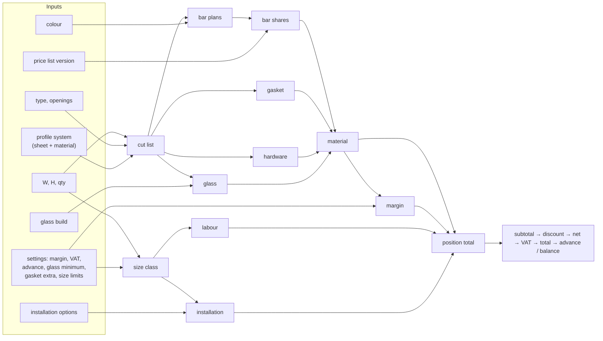

### 4.9 The full worked example

**Input:** REHAU Euro-Design 70 (demo catalogue), single sash tilt-and-turn, readings widths 832/830/831 and heights 1432/1430/1445, white, glass 4-16-4, opening `tilt_turn_left`, qty 1, standard installation (no options), 20 km transport, margin 25%, no discount, demo workshop (not VAT-registered). Every number below is real engine output.

| Step | Calculation | Cents | € |
|---|---|---|---|
| Size | `830 − 2 × 10 = 810`, `1430 − 2 × 10 = 1410` | | |
| frame/white bars | 1 bar × (3.60 €/m × 6 m) | 2,160 | 21.60 |
| sash/white bars | 1 bar × (4.10 €/m × 6 m) | 2,460 | 24.60 |
| bead/white bars | 1 bar × (0.90 €/m × 6 m) | 540 | 5.40 |
| steel bars | 2 bars × 8.70 € | 1,740 | 17.40 |
| gasket | `8704 + pct(8704, 500) = 8704 + 435 = 9139 mm`; `per_metre(9139, 40)` | 366 | 3.66 |
| hardware tilt_turn_left | 1 set × 32.00 € | 3,200 | 32.00 |
| glass 4-16-4 | `678 × 1278 = 866,484 mm²` (above the 0.3 m² minimum); `per_m2(866484, 1800)` | 1,560 | 15.60 |
| consumables | 1 × 2.50 € | 250 | 2.50 |
| **Material** | sum | **12,276** | 122.76 |
| Margin | `pct(12276, 2500)` | 3,069 | 30.69 |
| Size class | `810 × 1410 = 1,142,100 mm²` → standard (between 1 and 2.5 m²) | | |
| Labour | `labour[pvc/single_sash_tilt_turn/standard]` | 2,000 | 20.00 |
| Installation | `installation[standard]` | 2,500 | 25.00 |
| **Position total** | 12,276 + 3,069 + 2,000 + 2,500; unit = `divide_half_up(19845, 1)`; rounding 0 | **19,845** | 198.45 |
| Per m² | `rate_per_m2(19845, 1142100)` | 17,376 | 173.76 /m² |
| Transport | `2000 + 30 × 20` | 2,600 | 26.00 |
| Subtotal | 19,845 + 2,600 | 22,445 | 224.45 |
| Discount | none | 0 | |
| Net | | 22,445 | 224.45 |
| VAT | not VAT-registered | 0 | |
| **Total** | | **22,445** | **224.45** |
| Advance (50%) | `pct(22445, 5000)` | 11,223 | 112.23 |
| Balance | 22,445 − 11,223 | 11,222 | 112.22 |
| Warning | `readings_spread`: height readings differ by 15 mm (more than 10) | | |

**Variant, worked by hand with the same helpers** (not a run): a VAT-registered workshop (18%) giving a 10% discount on the same job:

```
discount = pct(22445, 1000) = 2245
net      = 22445 − 2245     = 20200
VAT      = pct(20200, 1800) = 3636
total    = 23836            (€238.36)
advance  = pct(23836, 5000) = 11918, balance = 11918
```

**The same window in all six demo systems** (real runs; 0 km, so transport is the €20 flat fee):

| System | Material | Depth | Quote total | Position per m² |
|---|---|---|---|---|
| REHAU Euro-Design 70 | PVC | 70 mm | €218.45 | €173.76 |
| Salamander greenEvolution 76 | PVC | 76 mm | €226.70 | €180.98 |
| REHAU SYNEGO 80 | PVC | 80 mm | €248.64 | €200.19 |
| Alumil COMFORT M9400 | Aluminium | 45 mm | €265.96 | €215.36 |
| Alumil SMARTIA S67 | Aluminium | 67 mm | €370.41 | €306.81 |
| Alumil SMARTIA M11000 | Aluminium | 77 mm | €444.88 | €372.02 |

For SMARTIA S67 the material lines are: frame bars €75.60 (9.0 €/kg × 1.4 kg/m × 6 m), sash bars €86.40, bead bars €10.80, gasket €5.03, hardware €40.00, glass €15.60, consumables €4.50 = €237.93; margin €59.48; labour €28.00 (aluminium, standard); installation €25.00.

**Other types** (Euro-Design 70, white, 4-16-4, standard installation, €20 transport): two fields with T-mullion 1400 × 1400 = €343.00; two sashes with false mullion 1400 × 1400 = €341.89; fixed 600 × 900 = €113.35; balcony door 800 × 2200 = €258.68.

### 4.10 Warnings (`engine/warnings.py`)

| Code | Trigger | Wired into calculations? |
|---|---|---|
| `readings_spread` | readings of one dimension differ by more than 10 mm | **Yes** (`calculate` and `POST /engine/measure`) |
| `price_list_old` | the price list is older than `price_age_warn_days` (default 30) | **Yes** |
| `margin_low` | the revision's margin is below `margin_warn_bp` (default 15%) | **Yes** |
| `sash_too_wide`, `sash_too_high`, `sash_too_large`, `sash_too_heavy` | a sash exceeds its hardware set's limits (width, height, area, weight from glass g/m² and profile g/m) | **No**: functions and tests exist (`hardware_warnings`), but the calculation service does not call them |
| `size_outside_system` | the window is outside the system's size limits | **No** (`size_warnings` exists, not called) |

Each warning is a `QuoteWarning(code, message, position_ref)`. Warnings never block a quote; missing data does (as an error).

### 4.11 Lists (`engine/lists.py`): **Built, not exposed**

`glass_order` (panes by build and size), `purchase_list(...)` (bars per profile and colour, steel, gasket in whole metres rounded up, hardware, glass), `price_request` (purchase lines grouped per supplier, for a "please quote" message), `quote_summary`. They are tested, but no API endpoint or screen uses them yet; turning them into Bosnian or Albanian message text and PDFs is milestone M7 (**Planned**).

### 4.12 The demo catalogue and its market prices (`services/demo_catalogue.py`, `docs/market-prices.md`)

**Important:** these are **market estimates from public sources, in euros excluding VAT, researched 13–14 November 2026; not any workshop's prices.** Kosovo makers and distributors publish no price lists, so most values are regional (Serbia, North Macedonia, Bosnia, Croatia, Turkey) adjusted to Kosovo, and several are assumptions. Every entry carries the note `PRICE_NOTE = "Procjena tržišta Kosova (bez PDV-a), nisu cijene radionice"`. Replacing them with real supplier quotes is **Owner input**. The full research with sources is in `reports/Kosovo PVC window prices.md` (not committed).

**Systems** (all documented as sold in Kosovo: Salamander via EB Group, REHAU with a Prishtina office, Alumil Kosovo):

| Tier | PVC | Aluminium |
|---|---|---|
| Budget | REHAU Euro-Design 70 (70 mm) | Alumil COMFORT M9400 (45 mm, no thermal break) |
| Mid | Salamander greenEvolution 76 (76 mm) | Alumil SMARTIA S67 (67 mm, thermal break) |
| Premium | REHAU SYNEGO 80 (80 mm) | Alumil SMARTIA M11000 (77 mm, thermal break) |

**PVC profile prices** (€ per metre, white, 6 m bars; bar price = €/m × 6):

| System | Frame | Sash | Mullion | False mullion | Bead | Threshold | Gasket €/m | Steel per bar |
|---|---|---|---|---|---|---|---|---|
| Euro-Design 70 | 3.60 | 4.10 | 4.15 | 4.10 | 0.90 | 4.15 | 0.40 | 8.70 |
| greenEvolution 76 | 4.05 | 4.65 | 4.70 | 4.65 | 1.00 | 4.70 | 0.40 | 8.70 |
| SYNEGO 80 | 5.25 | 6.00 | 6.10 | 6.00 | 1.30 | 6.10 | 0.45 | 8.70 |

PVC foil: +25% one side, +45% both sides.

**Aluminium profile prices** (€ per kg × kg per metre):

| System | €/kg | Frame | Sash | Mullion | False mullion | Bead | Threshold | Gasket €/m |
|---|---|---|---|---|---|---|---|---|
| M9400 | 6.50 | 1.0 | 1.1 | 1.2 | 1.1 | 0.2 | 1.2 | 0.50 |
| SMARTIA S67 | 9.00 | 1.4 | 1.6 | 1.5 | 1.6 | 0.2 | 1.5 | 0.55 |
| SMARTIA M11000 | 11.00 | 1.5 | 1.75 | 1.6 | 1.75 | 0.25 | 1.6 | 0.70 |

Aluminium wood-grain finish: +10% one side, +14% both sides. No steel.

**Shared prices:**

| Item | PVC | Aluminium |
|---|---|---|
| Hardware, tilt-and-turn / turn | €32 / €22 | €40 / €28 |
| Consumables per window | €2.50 | €4.50 |
| Labour small / standard / large | €15 / €20 / €28 | €21 / €28 / €39 |

Glass per m²: `4-16-4` €18, `4-16-4 Low-E Ar` €21, `4-12-4-12-4 Low-E Ar` €33. Installation: small €20, standard €25, large €35; RAL installation +€25; old window removal €15; wall repair €20. Transport €20 flat + €0.30 per km. Sills (white) `PVC 200 mm` €16/m, `PVC 250 mm` €20/m, `PVC 300 mm` €24/m. Shutters `PVC` €30/m², `aluminij izolirani` €38/m². Screens `fiksni` €22/m², `rolo` €35/m², `plisirani` €40/m².

**Calibration.** Labour was tuned so that installed windows land on regional targets (white, 5-chamber, double glazing, installed: single sash 800 × 1400 about €145, per m² about €135, range €110–170; thermal-break aluminium about €270/m²). On an 8-opening house job with standard installation the demo gives: Euro-Design 70 €150/m², greenEvolution 76 €156, SYNEGO 80 €173, M9400 €190, SMARTIA S67 €270, SMARTIA M11000 €326. A single-window quote is higher (€173.76/m² above) because it pays for whole bars it does not fill.

### 4.13 How errors reach the user

| Engine error | HTTP (`api/problems.py`) | Problem title | Frontend |
|---|---|---|---|
| `MissingConstant` | 422 | "missing catalogue value" | quote screen shows "Cannot calculate: …" with the detail |
| `MissingPrice` | 422 | "missing price" | same |
| `InvalidInput` | 422 | "invalid input" | same |

All errors are RFC 9457 `application/problem+json` and never echo the request input.

### 4.14 Known limits of the engine

- All deductions are samples; no real system sheet exists in the repository.
- The balcony-door threshold is not cut or priced.
- Hardware and size-limit warnings are not wired in.
- The optimizer plans one job at a time; offcuts are not stored between jobs (v2 in PLAN.md).
- Aluminium rules (no weld allowance, no steel, PVC gap table) are assumptions awaiting the owner.
- The exact solver, when it hits its wall-clock limit, may not give exactly the same plan twice (it is not used for quotes).

---

## 5. Features and workflows

### 5.1 Feature list

| Feature | Backend | Frontend | Status |
|---|---|---|---|
| Login with email and password | `POST /auth/login` | `Login.tsx` | Built, unverified (DB) |
| Admin TOTP step | `POST /auth/totp` | `Totp` in `Login.tsx` | Built, unverified |
| Password re-check (step-up) | `POST /auth/reauth` | dialog in `Admin.tsx` | Built, unverified |
| Quotes list with search and status filter | `GET /quotes` | `QuotesList.tsx` | Built, unverified |
| New quote: pick or add client, pick system | `POST /clients`, `POST /quotes`, `GET /systems` | `NewQuote.tsx` | Built, unverified |
| Add or edit a window: measure, type, details | `POST /engine/measure`, `PUT /quotes/{id}/revisions/{n}` | `position/*` | Built (measure), unverified (save) |
| Copy the previous window | | `?copy=` in `PositionEditor` | Built |
| Live price, layers, cutting plan, warnings | `POST /quotes/{id}/revisions/{n}/calculate` | `QuoteScreen.tsx`, `CuttingPlan.tsx` | Built, unverified |
| Discount, transport, margin per quote | revision fields | "Popust i prevoz" in `QuoteScreen` | Built, unverified |
| Status changes (send, accept, reject, back to draft) | `POST /quotes/{id}/status` | `QuoteScreen` | Built, unverified |
| New revision, diff between revisions | `POST /quotes/{id}/revisions`, `GET …/diff` | "New version" button (diff: API only) | Built, unverified |
| Share as text (Viber/WhatsApp via the phone's share sheet) | | `navigator.share`, clipboard fallback | Built |
| Payments (advance, balance) | `GET/POST /quotes/{id}/payments` | `QuoteScreen` | Built, unverified |
| Price lists, supplier "+X%", settings | `/price-lists…`, `/suppliers…`, `/settings` | `Admin.tsx` | Built, unverified |
| Client export and erase (privacy) | `GET /clients/{id}/export`, `POST /clients/{id}/erase` | none | API built, unverified |
| Admin catalogue: systems, sheets, profiles, hardware sets, construction types, users, sessions | `/systems…`, `/profiles`, `/hardware-sets…`, `/construction-types`, `/users…`, `/sessions…` | none | API built, unverified; UI **Planned** |
| Optimizer comparison (FFD vs exact) | `POST /admin/compare-optimizer` | none | Built, unverified |
| Extras (sills, shutters, screens, manual lines) | revision `extras`, pricing | none | Engine and API built; UI **Planned** |
| Client PDF, workshop PDF, glass order, supplier message | engine lists exist | none | **Planned** (M7) |
| Demo workshop | `manage.py seed-demo / wipe-demo`, `is_demo` | `DemoBanner` | Built; nightly wipe **Planned** |
| Bosnian / English | | `i18n/` | Built |

### 5.2 The owner's main workflow

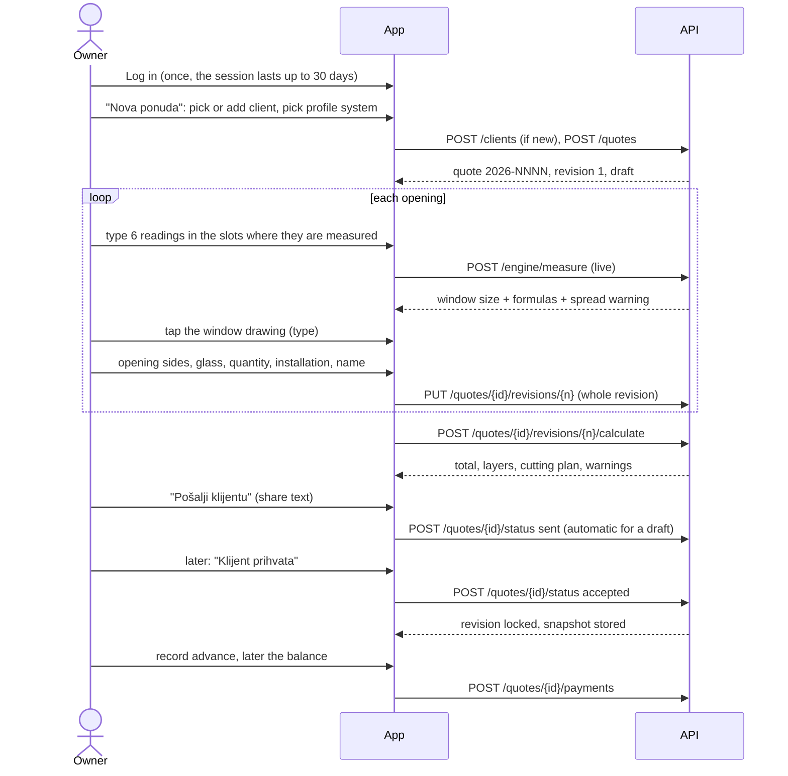

### 5.3 Quote lifecycle (`services/quotes.py: TRANSITIONS, effective_status`)

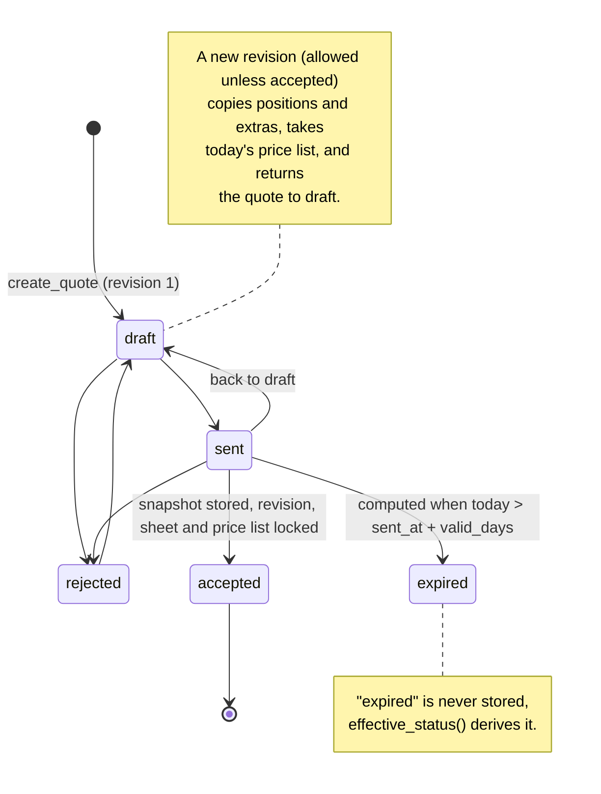

- **Numbering:** `YYYY-NNNN` per workshop (`next_number`).
- **Validity:** `valid_until = sent_at + valid_days` (default 15 days).
- **Editing:** only a draft's **current** revision can be changed (`replace_content`); a sent quote is changed through a new revision; an accepted quote can never change.
- **Acceptance** (`set_status` → `accepted`): `calculate()` is run one last time, its full result is stored in `quote_revisions.calc_snapshot`, the revision gets `locked_at`, and the system-sheet version and price-list version it used are locked. From then on the calculate endpoint returns the snapshot, so the accepted price can never drift.
- **Payments** are accepted only for accepted quotes; `paid_cents` sums them.
- **Audit:** state changes write `audit_log` rows (`services/quotes.py: audit`).

### 5.4 Price lists and the supplier "+X%" (`api/routes_admin.py`)

Price lists are versions (`price_list_versions`) with a `valid_from` date; the current list for a date is the newest with `valid_from ≤ today` (`current_price_list`). A version is never edited after a revision uses it. "A supplier changed prices" (`POST /price-lists/{id}/bump`, needs step-up) copies the list into a new version and changes only that supplier's entries by the given percentage, rounded half up, with the note `+X% · <supplier>`.

### 5.5 Settings (`settings` table, `services/workshops.py: DEFAULT_SETTINGS`)

| Setting | Default | Meaning |
|---|---|---|
| `margin_default_bp` | 2500 (25%) | margin of a new quote |
| `margin_warn_bp` | 1500 (15%) | `margin_low` below this |
| `vat_bp` | 1800 (18%) | used only if the workshop is VAT-registered |
| `advance_bp` | 5000 (50%) | advance share |
| `quote_valid_days` | 15 | validity |
| `price_age_warn_days` | 30 | `price_list_old` after this |
| `glass_min_area_mm2` | 300,000 (0.3 m²) | billable minimum per pane |
| `gasket_extra_bp` | 500 (5%) | gasket waste allowance |
| `small_max_mm2`, `standard_max_mm2` | none (required at creation) | size classes |

PLAN.md section 15 lists the defaults that still need the owner's confirmation (weld allowance, kerf, trim, bar length, steel shortening, glass minimum, deductions, margin, validity).

### 5.6 Command-line tools (`manage.py`, `export_openapi.py`)

| Command | Does |
|---|---|
| `python -m quote_engine.manage migrate` | run Alembic migrations to head |
| `… create-workshop "Name" --small-max-mm2 N --standard-max-mm2 N` | create a workshop with its default settings |
| `… create-user <workshop-id> <email> --role owner\|admin` | create a user; the password is typed (or read from `QUOTE_ENGINE_NEW_PASSWORD`), at least 12 characters; an admin also gets a TOTP secret, shown once |
| `… seed-demo` | wipe and recreate the demo workshop with invented data (three suppliers, six systems with sheets, hardware sets, a price list, a sample client); prints a newly generated demo password |
| `… wipe-demo` | delete the demo workshop |
| `python -m quote_engine.export_openapi [--check]` | write or check `frontend/openapi.json` |
| `python -m benchmarks.run` (in `backend/`) | the optimizer benchmark |

### 5.7 API reference (prefix `/api/v1`)

Access levels: **public**, **partial** (any valid session, also before an admin's TOTP step), **logged in**, **step-up** (logged in with a password check in the last 15 minutes), **admin**, **admin + step-up**. See `api/deps.py` for the dependencies. The catalogue, price-list, supplier, settings, user and session routes are defined in `api/routes_admin.py` but mounted directly under `/api/v1` (no `/admin` prefix); only the optimizer comparison is under `/admin/`.

| Method and path | Access | Purpose |
|---|---|---|
| `GET /health` | public | 200 `ok`, or 503 `degraded` when the database is down |
| `POST /auth/login` | public | email + password; sets cookies |
| `POST /auth/totp` | partial | admin's 6-digit code |
| `POST /auth/reauth` | partial | password again (step-up) |
| `GET /auth/me` | partial | current user and workshop (the app uses it to decide between login, TOTP and the app) |
| `POST /auth/logout` | partial | deletes the session |
| `GET, POST /clients`; `GET, PATCH /clients/{id}` | logged in | clients |
| `GET /clients/{id}/export` | step-up | everything stored about a client |
| `POST /clients/{id}/erase` | step-up | erase name and phone (name becomes "(erased)") |
| `GET, POST /quotes`; `GET /quotes/{id}` | logged in | quotes |
| `POST /quotes/{id}/revisions` | logged in | new revision |
| `PUT /quotes/{id}/revisions/{n}` | logged in | replace a draft's current revision |
| `GET /quotes/{id}/revisions/{first}/diff/{second}` | logged in | diff between two revisions |
| `POST /quotes/{id}/revisions/{n}/calculate` | logged in | calculate (or return the snapshot) |
| `POST /quotes/{id}/status` | logged in | status change |
| `GET, POST /quotes/{id}/payments` | logged in | payments |
| `POST /engine/measure` | logged in | readings → size, formulas, warnings |
| `POST /engine/preview` | logged in | calculate unsaved content |
| `GET /systems` / `POST /systems`, `PATCH /systems/{id}` | logged in / admin | profile systems |
| `GET /systems/{id}/sheets` / `POST` | logged in / admin + step-up | system sheet versions (material must match the system) |
| `GET /profiles` / `POST` | logged in / admin | profiles (code, grams per metre) |
| `GET /hardware-sets` / `POST`, `PUT /hardware-sets/{id}` / `DELETE` | logged in / admin / admin + step-up | hardware sets and their limits |
| `GET /construction-types` / `PUT` | logged in / admin | switch construction types on or off |
| `GET /price-lists`, `GET /price-lists/{id}` | logged in | price lists |
| `POST /price-lists`, `POST /price-lists/{id}/bump` | step-up | new version, supplier bump |
| `GET, POST /suppliers`, `PATCH /suppliers/{id}` | logged in | suppliers |
| `GET /settings` / `PUT` | logged in / step-up | settings |
| `GET /users` / `POST`, `PATCH /users/{id}` | admin / admin + step-up | users (deactivating deletes their sessions) |
| `GET /sessions`, `DELETE /sessions/{id}` | admin | sessions, revoke |
| `POST /admin/compare-optimizer` | admin | FFD vs exact on given pieces |
| `GET /dev/catalogue`, `POST /dev/calculate`, `POST /dev/measure` | public, **development only** | the demo path (section 3.6) |

The OpenAPI document is served at `/api/v1/openapi.json` and interactive docs at `/api/v1/docs`.

---

## 6. User interface and experience

### 6.1 Design direction

There are no Figma designs. On 13 November 2026 Mirza decided the screens would be designed from PLAN.md section 7 with a structured design workflow whose records are in `.impeccable/` (the direction contract is `.impeccable/surfaces/frontend-src-app-tsx.md`). `DESIGN.md` documents the system as built.

**North star: "Pencil on the Site Wall."** The app looks like the wall of a building site after the owner measured it: skimmed plaster ground, carpenter's-graphite ink and top bar, a **blue chalk line** for whatever he is working on now, **red marking crayon** only for things to re-check, and a quiet **green** only for accepted or paid. Every size is written like a dimension string on a drawing (number on top, a line with end ticks under it). The number he says out loud is always the biggest thing on the screen. There is no imagery and no logo; the only drawings are the windows themselves.

The principles (`PRODUCT.md`): every number explains itself; built for the site, not the desk; never guess; what the client accepted stays accepted; the workshop's own words.

### 6.2 Screens

| Screen | File | What the owner sees and does |
|---|---|---|
| **Login / TOTP** | `screens/Login.tsx` | Email and password; admins then enter a 6-digit code. Clear messages for a wrong password and for the 15-minute lock-out. The app name sits on a dimension string. |
| **Quotes list** | `screens/QuotesList.tsx` | Search by number or client, status filters (all, draft, sent, accepted, expired, rejected), each row with number, client, status pill and total ("nije izračunato" for a draft without a total). A fixed "Nova ponuda" button. |
| **New quote** | `screens/NewQuote.tsx` | Search a client by name, phone or place, or add one (React Hook Form + Zod); pick the profile system from a list grouped into PVC and Aluminij; "Napravi ponudu". |
| **Position editor, step 1: measure** | `screens/position/MeasureStep.tsx` | A drawing of the opening with **six reading slots placed where they are measured**: three widths across (top, middle, bottom), three heights down (left, middle, right). The cursor jumps to the next slot when a reading is finished. Colour row (white, foil outside, foil both sides). The engine computes the size live through `POST /engine/measure`; the smallest reading is circled; readings too far apart turn red with a warning. The bottom sheet shows the window size in the largest numerals and a "Kako je izračunato?" toggle with the formulas. "Upiši veličinu" skips measuring. |
| **Step 2: type** | `screens/position/TypeStep.tsx` | The five construction types as window drawings; the drawing is the button. |
| **Step 3: details** | `screens/position/DetailsStep.tsx` | Opening side per field (drawn), glass chips from the current price list, quantity stepper, installation chips (installation, RAL, removal of the old window, wall repair), a name. "Spremi prozor" lists exactly what is still missing if it cannot be saved. |
| **Quote** | `screens/QuoteScreen.tsx` | Positions as rows (drawing, size, quantity × unit price), each opening into material, margin, labour and installation; warnings as red notes; discount, transport and margin; the cutting plan; payments; status actions (mark as sent, client accepts, client declines, back to draft, new version); a fixed bottom sheet with "Ukupno za klijenta" that opens into the full layer list ("Od čega se sastoji?"); "Pošalji klijentu" shares a text summary (phone share sheet, clipboard on a PC) and marks a draft as sent. |
| **Cutting plan** | `screens/CuttingPlan.tsx` | Per group, each bar drawn as a strip with its cuts sized to scale and the hatched offcut always last, followed by the list of lengths. |
| **Prices and settings** ("Cijene i postavke") | `screens/Admin.tsx` | Current price list (valid from, number of items), "Dobavljač je promijenio cijene" (pick the supplier from a list, the %, the date → a new price-list version, with a password re-check), quote settings (margin, warning level, VAT, advance, validity, price-age warning), log out. Suppliers cannot be added or edited here yet (the API and a `useUpdateSupplier` hook exist). |

The language toggle (Bosanski / English) is on the login screen and the quotes list; the choice is kept in `localStorage["mjera.language"]`. The last profile system, colour and glass are remembered in `localStorage["mjera.last"]`.

### 6.3 Window drawings (`components/WindowDrawing.tsx`)

SVG drawings seen from inside: frames and sashes are rings with **45° mitred corners**, the T-mullion butts at **90°**, glass is filled with chalk tint, foil on both sides is hatched. Opening symbols follow the European convention: the triangle points to the hinge side, dashes show tilt, the handle is on the opposite side. `*_left` is drawn as "hinges on the left, seen from inside" (a DIN-style assumption; **Owner input** to confirm). Lines stay 2 px at any size (1.25 px in thumbnails, through a `stroke` prop).

### 6.4 Design tokens (`frontend/src/index.css`, `DESIGN.md`)

| Token | Hex | Use |
|---|---|---|
| `plaster` | `#e6e8e7` | page ground |
| `plaster-deep` | `#d3d8d7` | segmented track, demo banner, draft pill, hatching |
| `board` | `#fafbfb` | rows, cards, fields, bottom sheet |
| `graphite` | `#23272b` | body ink, drawing lines |
| `graphite-soft` | `#4b5258` | secondary text, units |
| `graphite-line` | `#7a838a` | field borders, inactive lines, disabled buttons |
| `shell` / `shell-raised` | `#23272b` / `#353b41` | top bar and its back button |
| `chalk` / `chalk-deep` / `chalk-tint` | `#1f5fd1` / `#174aa6` / `#dbe5f7` | the one action colour, hover, fills |
| `crayon` / `crayon-tint` | `#b42a17` / `#f6dcd6` | re-check, errors, expired |
| `tick` / `tick-tint` | `#17653a` / `#d6ebdf` | accepted, paid |

**Typography:** Noto Sans variable, self-hosted, root size 17 px. Numbers use a "figure" style (87.5% width, weight 800, tabular lining numerals) in exactly three sizes: 2.75rem (the one number said aloud), 1.5rem (reading slots, position prices), 1.0625rem (lists, cut lengths, formulas).

**Layout:** one column, phone first, 1rem gutters, centred at 48rem on a PC; every screen is top bar → work → bottom sheet with the result and the one primary action; tap targets at least 44 px (2.75rem), main controls 56 px (3.5rem). Flat surfaces; shadows only on the bottom sheet and a lifted (open or chosen) item. Named rules: one chalk-blue primary action per screen; red only for re-check; green only for accepted or paid; body ink near 13:1 contrast for sunlight.

**Components** (`components/ui.tsx`): `Button` (primary, secondary, quiet, danger), `IconButton`, `Field`, `TopBar`, `LanguageToggle`, `DemoBanner`, `TickLine`, `SizeMark` (dimension string), `Loading`, `ErrorNote`, `Segmented`; `Icon.tsx` is an authored icon set on a 24 px grid.

### 6.5 Language and trade words

Bosnian is the default, English one tap away (`i18n/bs.json`, `i18n/en.json`). Engine labels ("frame top", "sash bead vertical") are turned into the trade's words by `lib/labels.ts` (štok, krilo, stub, štulp, lajsna, armatura, dihtung, okov, staklo, klupčica, roletna, komarnik). These words still need checking with the owner (**Owner input**). Albanian is planned only for the client PDF.

### 6.6 Accessibility and quality checks

- axe (WCAG 2.2 AA) reported 0 violations on 9 screens (recorded in `docs/PROGRESS.md`).
- Every control has a 3 px chalk focus ring; a reduced-motion rule is in `index.css`; sizes use `inputmode="numeric"`.
- Vitest: 24 tests in 3 files (`lib/lib.test.ts`, `components/WindowDrawing.test.tsx`, `screens/screens.test.tsx`), all passing on 15 November 2026.
- `e2e/owner.spec.ts` (Playwright on a Pixel 7 profile: login, two windows, total, axe) is written but needs the running stack and the seeded demo password.

### 6.7 Not built in the UI

Admin catalogue screens (systems and sheets, profiles, hardware sets, construction types, users, sessions), adding or editing suppliers, editing extras, client export and erase, the revision diff view, the optimizer comparison, PDFs and their sharing, the price per m² market check, and a two-column PC layout.

---

## 7. Database

### 7.1 Conventions

- PostgreSQL 18, SQLAlchemy 2 typed models in `db/models.py`, base classes in `db/base.py`: every table has `id` (UUID), `created_at`, `updated_at`.
- **Every workshop table** uses the `WorkshopScoped` mixin (`workshop_id` foreign key) and is listed in `WORKSHOP_SCOPED`; the only table without it is `login_attempts` (it is written before anyone is logged in).
- Money is `amount_cents` (BigInteger for price entries), lengths are millimetres, percentages basis points; flexible data (readings, openings, installation options, system-sheet constants, snapshots, audit diffs) is JSONB.
- Sessions: `db/session.py` (`get_engine` with `pool_pre_ping` and a 5 s connect timeout; `db_session` commits or rolls back per request).

### 7.2 Entity relationships

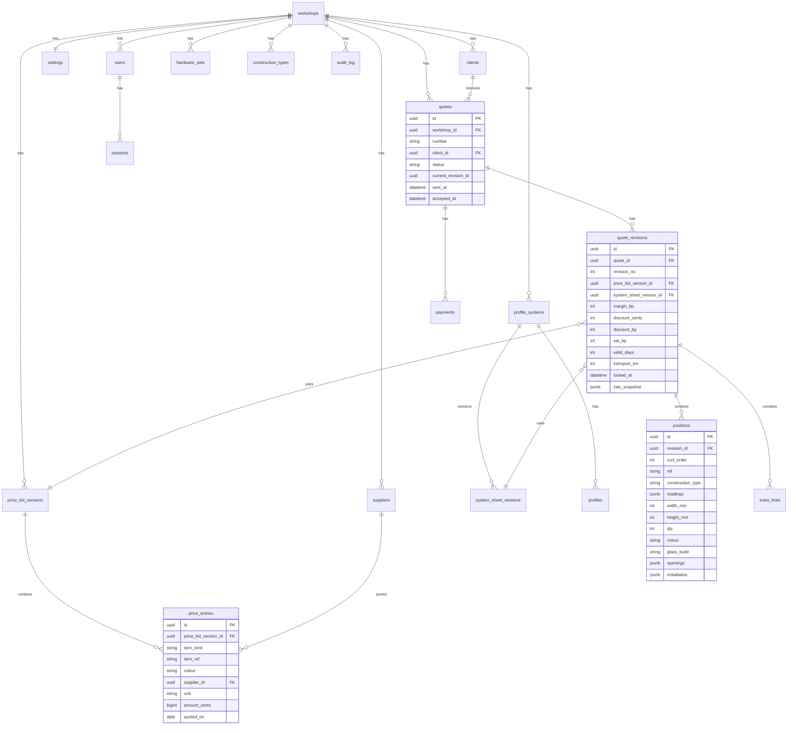

### 7.3 Tables

| Table | Main columns | Notes |
|---|---|---|
| `workshops` | name, address, phone, vat_number, vat_registered, is_demo | the tenant |
| `users` | email (unique), password_hash, role (`owner`/`admin`), totp_secret, is_active | |
| `sessions` | token_hash (unique), user_id (cascade), last_seen_at, reauth_at, totp_ok, csrf_token, user_agent | only the SHA-256 hash of the token is stored |
| `login_attempts` | username, ip, at, success | not workshop-scoped; feeds the rate limit |
| `audit_log` | user_id, action, entity, entity_id, at, diff (JSONB) | |
| `clients` | name, phone, place, erased_at | erase clears personal data |
| `suppliers` | name, phone, kind | |
| `profile_systems` | key, brand, series, material (default `pvc`, migration 0002), depth_mm, enabled | |
| `system_sheet_versions` | profile_system_id, version, constants (JSONB), source_pages (JSONB), locked | unique (system, version); only ever added |
| `profiles` | profile_system_id, role, code, g_per_m | weights for future hardware warnings |
| `construction_types` | key, enabled | unique (workshop, key) |
| `hardware_sets` | name, opening_type, max_width_mm, max_height_mm, max_area_mm2, max_weight_g | limits for future warnings |
| `price_list_versions` | valid_from, locked, note | only ever added |
| `price_entries` | item_kind, item_ref, colour, supplier_id, unit, amount_cents, quoted_on | one row per price-book key |
| `settings` | the settings in section 5.5 | one row per workshop |
| `quotes` | number (unique per workshop), client_id, status, current_revision_id, sent_at, accepted_at | |
| `quote_revisions` | revision_no (unique per quote), price_list_version_id, system_sheet_version_id, margin_bp, discount_cents, discount_bp, vat_bp, valid_days, transport_km, locked_at, calc_snapshot | |
| `positions` | sort_order, ref, construction_type, readings, width_mm, height_mm, qty, colour, glass_build, openings, installation | |
| `extra_lines` | sort_order, kind, ref, colour, length_mm, area_mm2, qty, manual_price_cents, description | |
| `payments` | quote_id, kind (`advance`/`balance`), amount_cents, received_on | |

### 7.4 Migrations

`migrations/versions/0001_baseline.py` creates the 20 tables; `0002_profile_system_material.py` adds `profile_systems.material`. A database test checks that the migrated schema matches the models. `migrations/env.py` reads the URL from settings and can reuse a given connection (for tests).

### 7.5 Immutability

Price-list versions and system-sheet versions are only ever added. Once an accepted revision uses them they are locked, and the accepted revision stores its full calculation in `calc_snapshot`. This is how "a price the client accepted never changes afterwards" is guaranteed even if prices or deductions are changed later.

### 7.6 Tests

The database tests (`tests/api/test_api_db.py`: 34 test functions, 51 test cases once parametrised; `docs/PROGRESS.md` still says 48) run against a real PostgreSQL in a separate `quote_engine_test` database, rebuilt from the migrations once per run, each test in a rolled-back transaction. Without a server they skip with a reason; with `QUOTE_ENGINE_REQUIRE_DATABASE=1` (CI) they fail instead. **They have never run**, so everything in this section is **Built, unverified**.

---

## 8. Security

Security follows PLAN.md section 9 and is mapped to OWASP ASVS Level 1 in `docs/security.md`. All of it is **Built, unverified** (the code and tests exist; the database-backed tests have not run), except the parts that need no database, which are **Built** and tested offline.

### 8.1 Authentication (`services/auth.py`)

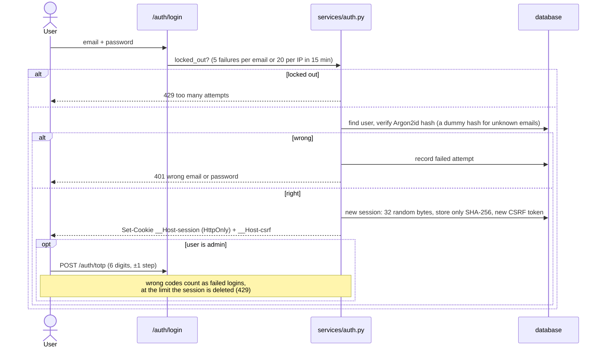

- **Passwords:** Argon2id (`argon2-cffi`), at least 12 characters for new users; unknown emails are checked against a dummy hash so timing does not reveal which emails exist.
- **Rate limit:** 5 failures per username or 20 per IP in 15 minutes. Wrong TOTP codes and wrong re-check passwords count as failed logins too (`_fail_inside_session`), closing a brute-force path found during a security review.
- **TOTP** for admins (`pyotp`, one step of clock drift allowed). The secret is shown once when the admin is created.

### 8.2 Sessions and cookies (`api/deps.py`)

- Token: `secrets.token_urlsafe(32)`; only `hash_token` (SHA-256) is stored. A new session (and token) on every login.
- Cookie `__Host-session`: HttpOnly, Secure, SameSite=Lax, Path=/. The `__Host-` prefix forbids a Domain attribute, so the cookie cannot be set by a subdomain.
- Idle timeout 7 days, absolute 30 days (`QUOTE_ENGINE_SESSION_IDLE_DAYS`, `…_ABSOLUTE_DAYS`); expired sessions are deleted when seen. Logout and admin revoke delete the row; deactivating a user deletes all their sessions.

### 8.3 CSRF

Double-submit: the `__Host-csrf` cookie (readable by the frontend) must match the `X-CSRF-Token` header on every POST, PUT, PATCH and DELETE, compared with `hmac.compare_digest` (`csrf_matches`).

### 8.4 Authorization

| Who | Can |
|---|---|
| Owner (logged in) | quotes, clients, calculations, payments, manage suppliers; read price lists, settings and the whole technical catalogue (systems, sheets, profiles, hardware sets, construction types) |
| Owner with step-up (password in the last 15 minutes; the login itself counts for its first 15 minutes) | new price list, supplier bump, change settings, export or erase a client |
| Admin | everything above plus creating and changing profile systems, profiles, hardware sets and construction types, listing users and sessions, revoking sessions, the optimizer comparison |
| Admin with step-up | new system-sheet version, delete a hardware set, create or change users |

This split (owner may change prices, suppliers and settings; only the admin changes the technical catalogue) is a decision awaiting Mirza's confirmation (**Owner input**).

### 8.5 Tenant isolation (`db/repository.py: Scoped`)

Every request gets a `Scoped` repository bound to the user's `workshop_id`; every `select`, `get`, `all`, `first`, `add` and `delete` filters by it. A row of another workshop raises `NotFoundError`, returned as **404, never 403**, so the existence of other workshops' data is not revealed. Every workshop table has a tenant-isolation test (database tests).

### 8.6 Input validation and error responses

- Pydantic schemas with `extra="forbid"`; sizes 300–3,500 mm, readings 300–4,000 mm (three each), quantity 1–99, known construction types only, unique position refs, one discount kind, material `pvc`/`aluminium`.
- Errors are RFC 9457 problem JSON (`api/problems.py`). Validation errors list only `field` and `message`, never the input value (tested: a long secret in a login request is not echoed). "Not found" does not echo the requested id.

### 8.7 HTTP headers (`infra/Caddyfile`)

`Strict-Transport-Security: max-age=31536000; includeSubDomains`, `Content-Security-Policy: default-src 'self'; frame-ancestors 'none'; base-uri 'self'; form-action 'self'`, `X-Content-Type-Options: nosniff`, `Referrer-Policy: same-origin`, and the `Server` header removed. The frontend is built to fit the CSP: self-hosted fonts, no inline `data:` assets.

### 8.8 Secrets

- No secrets are committed. `compose.yaml` contains a development-only database password for the local stack, whose ports are bound to `127.0.0.1`.
- Production secrets: only in `/etc/quote-engine/app.env` (root-only) on the server, and the `DEPLOY_*` secrets in a GitHub `production` environment. Production requires `QUOTE_ENGINE_DATABASE_URL` to be set (no fallback).
- `.env` files are ignored at every depth in the Docker build context.
- Before anything is published, everything that would become public is audited for secrets, private data and billing risks (Mirza's standing instruction).

### 8.9 Privacy

- Kosovo's data-protection law 06/L-082 applies; `docs/privacy.md` describes what is kept, why, how long, and export and erase.
- No real client names, phones or prices in code, fixtures, tests or logs; the demo uses invented data (`demo@example.invalid`, "Probna radionica (izmišljeni podaci)", "Probni klijent"), tested by `test_demo_data_is_marked_as_sample`.
- Client export and erase exist in the API.
- **Planned:** the nightly retention job (erase names and phones of rejected or expired quotes after 12 months), the nightly demo wipe, and Sentry with `send_default_pii=False` and a scrubbing `before_send`. How long login attempts and the audit log are kept is **Owner input**.

### 8.10 Development endpoints

`/api/v1/dev/*` have no authentication, but are mounted only when `QUOTE_ENGINE_DEV_DEMO=1` and the environment is not `production`, use no database and touch no real data (tested).

### 8.11 Proxy headers

The container starts uvicorn with `--proxy-headers --forwarded-allow-ips *`, so the client IP for the rate limit comes from `X-Forwarded-For`. This is safe only because in production the app is reachable solely through Caddy on the internal Docker network (`expose`, not `ports`). Publishing the app port directly would let clients spoof their IP for the per-IP limit.

### 8.12 Security work not done

- The database tests (auth, CSRF, tenancy, snapshot; 51 test cases) have never run.
- CI's planned dependency audits (pip-audit, npm audit), Gitleaks and Trivy are not added. `npm audit` reported 10 moderate findings in development-only ESLint tooling during M0.
- Sentry, retention jobs, demo-wipe scheduling.
- CodeQL action pinned by tag (`v3`), not by commit SHA.

---

## 9. Development status

### 9.1 Milestones (`docs/PLAN.md` section 14, `docs/PROGRESS.md`)

| Milestone | Status | Notes |
|---|---|---|
| M0 Repo and tooling | done | merged into `main`; CI passed once on GitHub (12 Nov 2026) |
| M1 Requirements | waiting for Mirza | with the workshop owner |
| M2 Engine types and measuring | done | |
| M3 Cut rules | done | real deductions must come from system sheets |
| M4 Optimizer | done | benchmark in `docs/optimizer.md` |
| M5 Pricing, warnings, lists, golden tests | waiting for Mirza | everything built; golden jobs are his real past jobs |
| M6 Database and API | in progress | written; database tests never run |
| M7 PDFs and messages | todo | |
| M8 Frontend | in progress | owner screens done; admin catalogue, extras, PDFs missing |
| M9 Deploy and operations | waiting for Mirza | files written, never run; needs a server, domain and GitHub repository |
| M10 Shadow mode and live use | waiting for Mirza | |
| M11 Docs and presentation | todo | |

### 9.2 Gates

| Gate | Condition | Status |
|---|---|---|
| Gate 1 | Figma screens paper-tested with the owner before any screen code | not met |
| Gate 2 | all golden tests pass (target 13 Dec 2026) | not met: `backend/tests/golden/jobs/` does not exist yet |
| Gate 3 | shadow mode matches the owner's quotes (target 24 Jan 2027) | not met |

M6, M7 and M8 were built before Gates 1 and 2 by Mirza's decision. The golden tests will still decide whether the engine is right; anything they catch is fixed afterwards.

### 9.3 Test results on 15 November 2026

| Suite | Result |
|---|---|
| Backend `uv run pytest` | **533 passed, 54 skipped**: 51 database test cases (no PostgreSQL) and 3 golden tests (no jobs yet); 1 warning (Starlette's test client says `httpx` is deprecated in favour of `httpx2`) |
| Frontend `npx vitest run` | **24 passed** (3 files) |
| Lint and types (last full local check) | Ruff, Ruff format, mypy strict, import-linter, ESLint and `tsc` clean |
| Accessibility | axe 0 violations on 9 screens |

Golden tests are the acceptance test PLAN.md defines: 5–10 of the owner's real past jobs, anonymised, whose cut lengths must match within ±1 mm and totals within ±3% using that date's prices. Their format is in `backend/tests/golden/README.md`; the folder is protected so only Mirza can write it.

### 9.4 Who wrote what

PLAN.md section 13 reserved several engine parts for Mirza (the gap table, the five cut formulas, FFD, the solver model, the cost split, the size classes). On 13 November 2026 he chose to have them written for him ("finish the whole project"); this is recorded as a deviation. His remaining parts are the real data: golden jobs, real system sheets, private price lists, and the decisions listed below.

### 9.5 Waiting for Mirza or the owner

- Golden jobs, real system sheets and the private price list of each job's date.
- Real supplier prices to replace the market estimates.
- Confirm the aluminium rules (crimped corners, no steel, same gaps as PVC).
- Confirm the opening-side convention (`*_left` = hinges on the left, seen from inside).
- Confirm or replace the name "Mjera"; check the Bosnian trade words with the owner.
- Confirm who may change what (owner vs admin rights).
- Size-class limits for the real workshop.
- Retention period for login attempts and the audit log.
- Restart Windows so Docker can start, then run the database tests.
- The server, domain and GitHub repository (M9); review ADR 0007; decide between `httpx` and its successor.

### 9.6 Recorded deviations from PLAN.md

Aluminium built although PLAN.md lists it for v2; screens designed without Figma; gates passed over by decision; steel as one optimizer group per job; benchmark on 300 orders instead of 1,000; the balcony door built as a single sash without a threshold; `SystemConstants` without defaults; mypy strict for the whole backend; the protection hook extended to PowerShell.

---

## 10. Installation and running

### 10.1 Prerequisites

- **uv** (it installs and manages Python 3.13).
- **Node.js 22.12 or newer** with npm.
- **Docker** (optional, for PostgreSQL and the full stack). On the development PC Docker Desktop needs a Windows restart before WSL 2 virtualization works.

### 10.2 Backend

```bash
cd backend
uv sync
uv run uvicorn quote_engine.main:app --reload
```

Health check: <http://localhost:8000/api/v1/health> (answers 503 "degraded" while no database is running). Interactive API docs: <http://localhost:8000/api/v1/docs>.

### 10.3 Frontend

```bash
cd frontend
npm ci
npm run dev
```

Vite serves <http://localhost:5173> and forwards `/api` to `http://localhost:8000`.

### 10.4 The demo without a database

Start the backend with the development demo switched on, then the frontend, then open `http://localhost:5173/?mock`:

```bash
cd backend && QUOTE_ENGINE_DEV_DEMO=1 uv run uvicorn quote_engine.main:app --port 8000
```

(In PowerShell: `$env:QUOTE_ENGINE_DEV_DEMO = "1"` before the `uv run` command.) The mock keeps quotes and clients in the browser tab's `sessionStorage` and prices them with the real engine on the demo catalogue.

### 10.5 Full stack with a database

```bash
docker compose up --build
```

The app container runs the migrations and starts on <http://localhost:8000>. Then create a workshop and a user:

```bash
docker compose exec app python -m quote_engine.manage create-workshop "Workshop name" --small-max-mm2 1000000 --standard-max-mm2 2500000
```

```bash
docker compose exec app python -m quote_engine.manage create-user <workshop-id> owner@example.invalid --role owner
```

Or seed the demo workshop (it prints a generated password): `python -m quote_engine.manage seed-demo`. The size limits above are the demo's; the real workshop's are **Owner input**.

### 10.6 Environment variables

| Variable | Default | Purpose |
|---|---|---|
| `QUOTE_ENGINE_ENVIRONMENT` | `development` | `production` turns off the dev demo and requires a database URL |
| `QUOTE_ENGINE_DATABASE_URL` | local compose database in development | PostgreSQL URL (required in production) |
| `QUOTE_ENGINE_SESSION_IDLE_DAYS` | 7 | session idle timeout |
| `QUOTE_ENGINE_SESSION_ABSOLUTE_DAYS` | 30 | session absolute timeout |
| `QUOTE_ENGINE_REAUTH_MINUTES` | 15 | step-up window |
| `QUOTE_ENGINE_DEV_DEMO` | off | `1` mounts `/api/v1/dev/*` (never in production) |
| `QUOTE_ENGINE_STATIC_DIR` | `/app/static` | where the built frontend is served from |
| `QUOTE_ENGINE_NEW_PASSWORD` | | password for `manage.py create-user` without a prompt |
| `QUOTE_ENGINE_TEST_DATABASE_URL` | local test database | database tests |
| `QUOTE_ENGINE_REQUIRE_DATABASE` | off | `1` makes database tests fail instead of skip (CI) |
| `E2E_PASSWORD` | | the demo password for the Playwright test |

### 10.7 Checks (required before every commit)

```bash
cd backend && uv run ruff check . && uv run ruff format --check . && uv run mypy && uv run lint-imports && uv run pytest
```

```bash
cd frontend && npm run lint && npm run typecheck && npm test && npm run build
```

Other useful commands: `uv run pytest tests/engine -q -m "not slow"` (fast engine tests), `uv run python -m quote_engine.export_openapi` then `npm run gen:api` (after API changes), `uv run python -m benchmarks.run` (optimizer benchmark), `npx playwright test` (needs the stack).

### 10.8 Production (**Written, never run**)

`docs/runbook.md` describes the first setup: an Oracle Always Free server prepared with `infra/setup-server.sh`, a domain pointing to it, `/etc/quote-engine/app.env` with the secrets, `infra/compose.prod.yaml` with Caddy for HTTPS, deploys through `.github/workflows/deploy.yml` and `infra/deploy.sh` (pull, migrate, start, health check, roll back on failure), and nightly `infra/backup.sh` with a restore drill (`infra/restore.sh`).

### 10.9 Git

Git is local only; there is no remote and nothing may be pushed until Mirza creates the repository. One branch per task (`feat/m<n>-<topic>`), Conventional Commits, never commit on `main`, merge into `main` only when Mirza says so. Current branches: `main`, `feat/m0-repo-tooling`, `feat/m2-engine-types`, `feat/m3-cut-rules`, `feat/m4-optimizer`, `feat/m5-pricing`, `feat/engine-parts`, `feat/m6-database-api`, `feat/m8-frontend` (current), `feat/m9-deploy`.

---

## 11. Technical assessment

### 11.1 Strengths

1. **A pure, explainable engine.** The calculation is separated from the web and the database by enforced import contracts, works only in whole numbers with one set of half-up rounding helpers, and attaches a formula to every length. It can be tested and audited in isolation, which is rare for quoting software.
2. **"Never guess" is real.** `SystemConstants` has no defaults; a missing deduction or price raises a named error that reaches the user as a clear 422. No silent zeros.
3. **Accepted prices cannot drift.** Versioned price lists and system sheets plus the stored calculation snapshot make an accepted quote reproducible forever.
4. **The cutting optimizer is measured.** FFD is benchmarked against an exact CP-SAT solver and a lower bound (94% optimal, never more than one bar off on 300 orders), and Hypothesis property tests guard against impossible plans.
5. **Testing and typing discipline.** 533 backend tests, mypy strict for the whole backend, Ruff with security rules, 24 frontend tests, axe checks, an OpenAPI freshness test that keeps frontend types in sync.
6. **Security designed in.** Argon2id, hashed session tokens, `__Host-` cookies, double-submit CSRF, rate limits that also cover TOTP and re-checks, step-up for sensitive actions, 404-not-403 tenancy, problem JSON that never echoes input, a strict CSP.
7. **A UI shaped by its real context.** Readings are typed where they are measured, the engine responds live, every total opens into its layers, and the design system is documented and consistent.

### 11.2 Weaknesses and risks

| Risk | Impact | Where |
|---|---|---|
| **Correctness is unproven against reality.** No golden jobs exist; all deductions are invented samples. | The cut lengths and totals have never been compared with a real window or a real invoice. This is the single biggest risk. | `tests/golden/`, system sheets |
| **Prices are estimates.** Market research with low-confidence assumptions (aluminium weights, labour, tier steps). | Demo totals look plausible but are not the workshop's prices. | `demo_catalogue.py`, `docs/market-prices.md` |
| **The database layer has never run.** 51 test cases skipped. | Auth, CSRF, tenancy and the snapshot flow are unverified at runtime. | `tests/api/test_api_db.py` |
| **Missing pieces of v1.** PDFs, admin catalogue screens, extras UI, price per m² display, purchase list and price-request exposure, hardware and size warnings. | The owner cannot yet run a workshop on it alone. | M7, M8 |
| **Deployment untested.** Dockerfile, compose, Caddy and scripts have never run. | First deploy may surface problems. | `infra/` |
| **Single-window pricing pays whole bars.** A deliberate rule, but a one-window quote is noticeably dearer per m² than a multi-window job. | The owner must understand or accept this; it may need a setting. | `pricing.py: _bar_costs` |
| **Aluminium is outside the original plan** and its rules are assumptions. | Aluminium quotes rest on unconfirmed construction rules. | `sheet.py`, `demo_catalogue.py` |
| **Opening-side convention** is assumed (DIN-style). | A drawing could show the hinge on the wrong side for this owner. | `WindowDrawing.tsx` |

### 11.3 Technical debt and small issues found while documenting

- `services/demo_catalogue.py` line 404 carries the same `# noqa: S610 (not Django)` comment five times on one line (left by a generation script); harmless, but should be reduced to one.
- `PositionPrice.cents_per_m2` and `area_mm2` are computed but unused by the frontend, although PLAN.md wants a per-m² market check.
- `pricing.PricingSettings.price_risk_bp` exists with no setting or UI feeding it.
- `hardware_warnings`, `size_warnings` and all of `engine/lists.py` are built and tested but not wired in (dead code until M7).
- The calculation result is typed by hand on the frontend (`api/types.ts`) because the API returns it as a free-form object; a typed response model would let the OpenAPI types cover it.
- `httpx` deprecation warning in the test client (a decision is pending).
- `docs/PROGRESS.md` still says "Vitest 22 tests"; there are now 24.

### 11.4 Recommendations, in order

1. **Get real data in.** One real system sheet and two or three golden jobs would turn the engine from "carefully built" into "proven". Everything else depends on this.
2. **Run the database tests** (restart Windows, `docker compose up db`, `uv run pytest`) and fix what they find.
3. **Replace the demo prices** with real supplier quotes for the systems the workshop actually buys, then recalibrate labour.
4. **Finish v1 for the owner:** PDFs (M7), extras in the UI, the per-m² market check, then the admin catalogue screens.
5. **Wire the hardware and size warnings** once real hardware limits and profile weights are entered.
6. **Add the CI security jobs** (dependency audits, secret scanning, image scanning) before the repository becomes public.
7. **Deploy to a staging server** and run the restore drill once, as the definition of done requires.
8. **Decide the small policies** waiting on the owner (rights, size classes, retention, opening convention, product name).

---

## Appendix A: Glossary

| English | Bosnian (app) | Code |
|---|---|---|
| Frame | štok | `Role.FRAME` |
| Sash | krilo | `Role.SASH` |
| Fixed T-mullion | stub | `Role.MULLION` |
| False mullion | štulp | `Role.FALSE_MULLION` |
| Glazing bead | lajsna | `Role.BEAD` |
| Threshold (balcony door) | prag | `Role.THRESHOLD` (no rule yet) |
| Steel reinforcement | armatura | `Role.STEEL` |
| Gasket | dihtung | `CutList.gasket_mm` |
| Hardware set | okov | `HardwareNeed` |
| Glass unit | staklo | `GlassPane` |
| Sill | klupčica | `ExtraKind.SILL` |
| Roller shutter | roletna | `ExtraKind.SHUTTER` |
| Insect screen | komarnik | `ExtraKind.SCREEN` |
| Weld allowance | | `weld_allowance_mm`, `a` |
| Kerf (blade width) | | `kerf_mm` |
| Steel shortening | | `steel_shortening_mm`, `s` |
| Offcut | ostatak | `Bar.offcut_mm` |
| System sheet | | `SystemConstants`, `system_sheet_versions` |
| Basis point | | `Bp` (100 bp = 1%) |
| Position | prozor / pozicija | `PositionSpec`, `positions` |
| Revision | verzija | `quote_revisions` |
| FFD | | First Fit Decreasing, `optimizer/ffd.py` |
| CP-SAT | | OR-Tools constraint solver, `optimizer/exact.py` |
| Step-up | | a fresh password check before a sensitive action |
| Tenant | radionica | a workshop; `workshop_id` |

("ostatak" and "verzija" are the words the app shows. "prag" and "prozor / pozicija" are plain translations given for orientation. Every word the app shows is in `frontend/src/i18n/bs.json` and `frontend/src/lib/labels.ts`.)

## Appendix B: File index

| File | Responsibility |
|---|---|
| `backend/src/quote_engine/main.py` | `create_app()`: routers, problem handlers, dev routes when enabled, static frontend |
| `backend/src/quote_engine/settings.py` | environment settings |
| `backend/src/quote_engine/manage.py` | command-line administration |
| `engine/units.py` | integer types and every rounding helper |
| `engine/model.py` | engine data model and enums |
| `engine/sheet.py` | system sheet reader |
| `engine/measuring.py` | gap table and `measure_opening` |
| `engine/rules/registry.py` | the five types, `check_position`, `cut_position`, `merge`, `cut_job` |
| `engine/rules/common.py` | formula terms and piece builders |
| `engine/rules/sashes.py` | shared sash, bead, glass, steel and gasket logic |
| `engine/rules/single_sash.py`, `two_field_t_mullion.py`, `two_sash_false_mullion.py`, `fixed.py`, `balcony_door.py` | one rule per type |
| `engine/optimizer/plan.py`, `ffd.py`, `bounds.py`, `exact.py`, `groups.py`, `validate.py` | cutting optimizer |
| `engine/prices.py` | price book |
| `engine/pricing.py` | every price layer |
| `engine/warnings.py` | warnings |
| `engine/lists.py` | purchase and order lists (not exposed yet) |
| `services/calculation.py` | database rows → engine → JSON result |
| `services/quotes.py` | quote lifecycle, revisions, locking, payments, audit |
| `services/auth.py` | passwords, sessions, TOTP, rate limits, step-up |
| `services/workshops.py` | workshops, users, default settings |
| `services/demo.py`, `services/demo_catalogue.py` | demo workshop and the market-estimate catalogue |
| `db/models.py`, `db/repository.py`, `db/session.py` | tables, tenancy, database sessions |
| `api/deps.py`, `api/problems.py`, `api/schemas.py` | auth dependencies, error format, request schemas |
| `api/routes_*.py` | the endpoints |
| `frontend/src/App.tsx`, `main.tsx` | app shell and routes |
| `frontend/src/api/*` | API client, hooks, generated types |
| `frontend/src/screens/*` | screens |
| `frontend/src/components/*` | UI kit, window drawings, icons |
| `frontend/src/lib/*` | formatting, readings, revisions, remembered choices, trade labels |
| `frontend/src/i18n/*` | translations |
| `frontend/src/dev/*` | development demo mock |
| `infra/*`, `compose.yaml`, `.github/*` | build, deployment, CI |
| `docs/PLAN.md` | the build specification |
| `docs/PROGRESS.md` | milestone status, decisions, deviations, open items |
| `docs/optimizer.md`, `docs/market-prices.md`, `docs/security.md`, `docs/privacy.md`, `docs/runbook.md` | topic documents |
| `PRODUCT.md`, `DESIGN.md` | product truth and design system |
