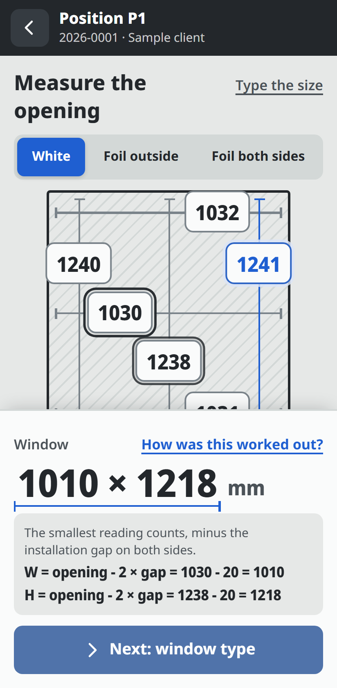
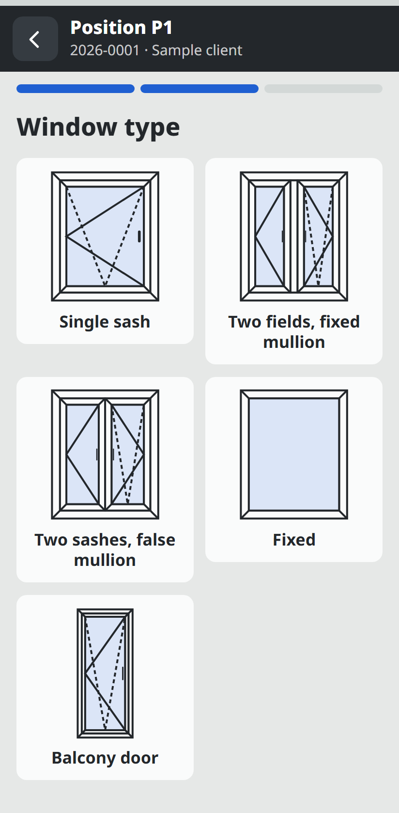
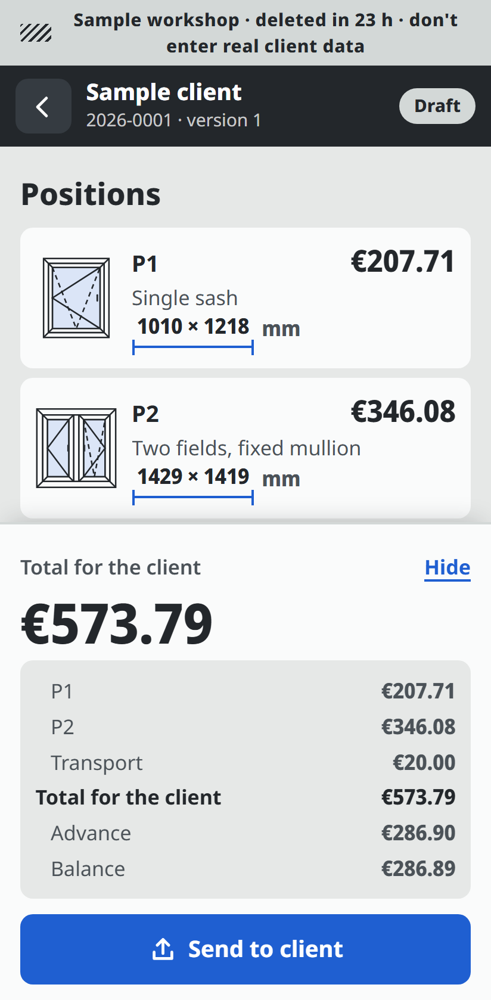
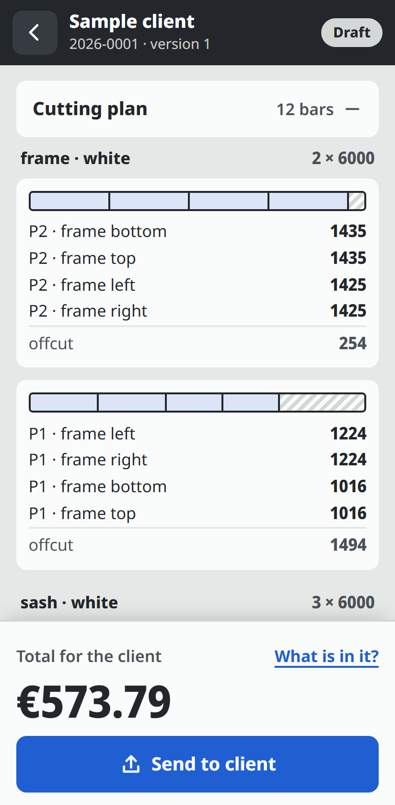
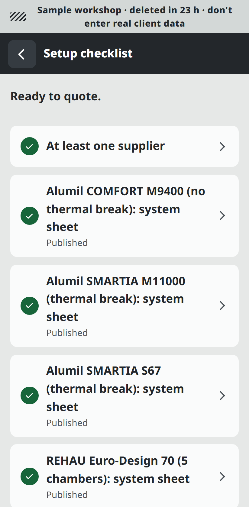
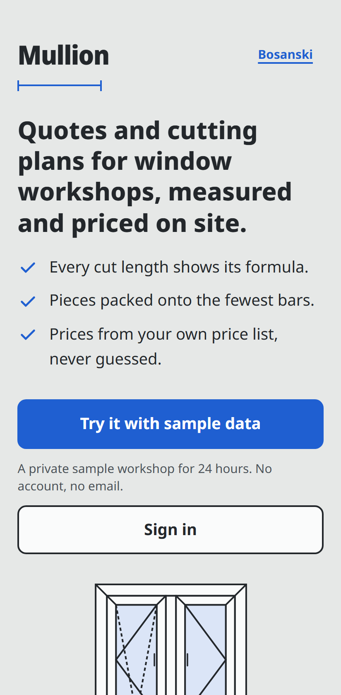
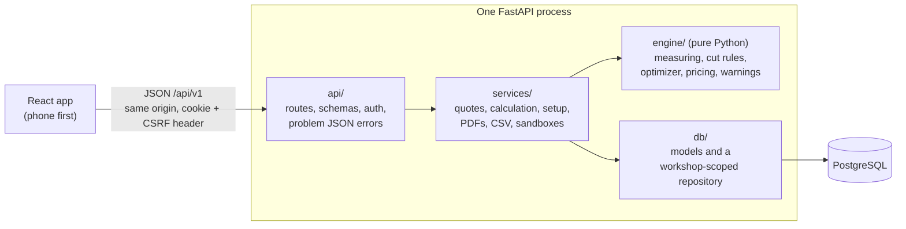

# Mullion

**Quotes and cutting plans for window workshops, measured and priced on site.**

Mullion turns six tape-measure readings of a wall opening into a priced quote, a cut list in which every piece shows its formula, and a cutting plan that packs the pieces onto as few stock bars as possible. It was built for a family-run PVC window workshop in Kosovo, and any workshop can use it with its own profile systems, deductions, prices and team.

I designed the quoting workflow around my father's workshop, planned the milestones, and reviewed the implementation. I used Claude Code to write the application code.

> **Status:** the quoting workflow, workshop setup, PDFs and multi-workshop accounts are built and tested against a real PostgreSQL database. The app is not deployed yet, and the engine still has to be checked against the workshop's real past jobs (see [Limitations](#limitations)).

| Measure | Pick the type | The quote |
|---|---|---|
|  |  |  |
| **Cutting plan** | **Setup checklist** | **Landing** |
|  |  |  |

Screenshots are taken from the running app in a "Try it" sandbox with invented sample data (`frontend/e2e/screenshots.spec.ts`).

## The problem

A small window workshop quotes with pencil and paper, and every opening repeats the same chain of work:

1. **Measure.** Walls are never square, so each opening is measured three times across and three times up. The smallest reading counts, and the window must leave an installation gap that depends on the size and on the profile's colour.
2. **Cut.** A window has 20 to 30 pieces (frame, sashes, beads, mullion, steel). Each length is the window size minus a deduction from the profile manufacturer's catalogue. A wrong deduction wastes profile and glass.
3. **Plan the bars.** Profiles come as 6 m bars. How the pieces are laid out decides how many bars are bought and how much is thrown away.
4. **Price.** Material from several suppliers, margin, labour, installation, transport, discount, VAT, a 50% advance.
5. **Keep it straight.** Clients ask for changes, quotes expire, and a price the client accepted must never change afterwards.

## Who uses it

- **The owner on site**, on a phone, often in sunlight with one free hand: measure, pick the window type, see the price, send the client PDF through the phone's share sheet.
- **The owner at the workshop PC**: price lists, system sheets, the cutting plan, payments, the team.
- **Staff**: quotes, clients and payments, nothing else.
- **Visitors**: "Try it" opens a private sample workshop for 24 hours, with no account.

## Features

**Quoting**
- Measuring with the size's formula on screen (`W = opening - 2 × gap = 1030 - 20 = 1010`) and a warning when one dimension's readings differ by more than 10 mm.
- Five construction types (single sash tilt-and-turn, two fields with a fixed mullion, two sashes with a false mullion, fixed, balcony door) in PVC and aluminium systems.
- A cut list where every piece carries its formula (`W + 2a = 1200 + 6 = 1206`), plus the glass order, hardware and steel reinforcement.
- A cutting plan per profile and colour: First Fit Decreasing for every quote; an exact CP-SAT solver to compare against.
- Prices in named layers: material (whole bars shared by the length each window uses, or used length plus the workshop's waste), margin on material, labour and installation by size class, extras (sills, shutters, screens, manual lines), transport, discount, VAT and the advance.
- Warnings: uneven readings, a sash beyond its hardware's limits, an old price list, a low margin, prices that are still estimates.
- Quote lifecycle: draft, sent, accepted or rejected; expiry is computed; editing a sent quote makes a new revision; an accepted quote is frozen with a snapshot of its calculation; advance and balance payments.
- PDFs: the client quote (English or Bosnian) and a workshop sheet without prices (bar strips, cut list, glass order, purchase list per supplier).

**Workshop setup**
- A setup checklist that asks the engine itself what is still missing.
- A system-sheet editor (every deduction with its catalogue page, a test cut), price-list drafts, CSV import and export with row-numbered errors, a supplier's "+X%" as a new version, and optional starter prices flagged as estimates.
- Owner and staff roles, one-time invite links, optional two-step login (TOTP), password re-checks for sensitive changes.
- Currency per workshop (EUR, BAM, RSD, ALL, MKD) and language (English, Bosnian).

## Tech stack

| Layer | Tools |
|---|---|
| Engine | Python 3.13, standard library only; OR-Tools CP-SAT for the exact solver |
| Backend | FastAPI, Pydantic 2, SQLAlchemy 2, Alembic, PostgreSQL 18, Argon2 (argon2-cffi), pyotp, WeasyPrint and Jinja2 for PDFs |
| Frontend | React 19, TypeScript 6, Vite 8, Tailwind CSS 4, TanStack Query 5, React Hook Form and Zod, i18next, React Router |
| Quality | pytest, Hypothesis, coverage; Ruff, mypy (strict), import-linter; Vitest and Testing Library; Playwright with axe |
| Delivery | Docker (multi-stage image), Caddy, GitHub Actions (CI, security scans, CodeQL; deploy written, see [Limitations](#limitations)) |

## Architecture



The same process serves the built frontend, so production has one origin and needs no CORS.

### Decisions that shape the code

- **A pure engine.** `quote_engine.engine` imports no web, database or validation framework, and only `optimizer/exact.py` may import OR-Tools. Two import-linter contracts enforce this on every check, so the whole calculation can be tested in milliseconds without a server.
- **Whole numbers only.** Lengths are millimetres, areas mm², money cents, percentages basis points (2500 = 25%). Rounding is half up, once per line, through the helpers in [`engine/units.py`](backend/src/quote_engine/engine/units.py). Shared costs are split with the largest-remainder method, so the parts always add up to the whole.
- **Every number explains itself.** A length is built from named terms, so its printed formula and its value cannot disagree ([`engine/rules/common.py`](backend/src/quote_engine/engine/rules/common.py)). Prices are lists of named lines.
- **Never guess.** A missing deduction or price raises `MissingConstant` or `MissingPrice`, which reaches the user as a 422 that names the missing value. Nothing falls back to a default.
- **What the client accepted stays accepted.** System sheets and price lists are versioned and locked once a quote uses them. Accepting a quote stores its calculation; a test recalculates from the stored versions and must get the same result.
- **Tenant isolation by construction.** Every query goes through [`db/repository.py: Scoped`](backend/src/quote_engine/db/repository.py), which filters by workshop. Another workshop's row is "not found" (404), never "forbidden", and one test per table tries to read another workshop's rows.
- **FFD for quotes, an exact solver to measure it.** On a benchmark of 300 random orders, First Fit Decreasing used the proven minimum number of bars on 94% of them and was never more than one bar off, in under a millisecond. Details: [`docs/optimizer.md`](docs/optimizer.md).
- **One contract between backend and frontend.** The frontend's types are generated from the backend's OpenAPI schema (`npm run gen:api`), and a test fails when `frontend/openapi.json` is out of date.
- **Errors are RFC 9457 problem JSON**, and they never echo the input or the cause of an unexpected error.

More: [`docs/security.md`](docs/security.md), [`docs/privacy.md`](docs/privacy.md), [`docs/runbook.md`](docs/runbook.md), and the architecture decision records in [`docs/adr/`](docs/adr/).

### Repository layout

```
backend/
  src/quote_engine/
    engine/      measuring, cut rules per window type, optimizer, pricing, warnings, lists
    services/    quotes, calculation, setup checklist, CSV, PDFs, auth, sandboxes, demo data
    api/         FastAPI routes and Pydantic schemas
    db/          SQLAlchemy models, the workshop-scoped repository
    migrations/  Alembic migrations, run with `python -m quote_engine.manage migrate`
    pdf/         templates, labels, window drawings
  tests/         engine, API (offline and on PostgreSQL), PDFs, property tests, golden-job harness
  benchmarks/    FFD against the exact solver and the lower bound
frontend/
  src/           screens, components, API client and generated types, i18n (en, bs)
  e2e/           Playwright: a visitor's first quote, with axe on each main screen
infra/           Dockerfile, production compose file, Caddyfile, deploy, backup and restore scripts
docs/            plan, progress, ADRs, optimizer benchmark, security, privacy, runbook
```

## Getting started

### With Docker

```
docker compose up --build
```

Open <http://localhost:8000> and press **Try it with sample data**. The app applies its migrations on start.

### For development

You need [uv](https://docs.astral.sh/uv/) (it installs Python 3.13), Node 22.12 or newer, and PostgreSQL 18: either `docker compose up db`, or a local server with this role and database:

```sql
CREATE ROLE quote_engine LOGIN PASSWORD 'local-dev-only' CREATEDB;  -- local development only
CREATE DATABASE quote_engine OWNER quote_engine;
```

Backend, at <http://localhost:8000> (API docs at `/api/v1/docs`):

```
cd backend
uv sync
uv run python -m quote_engine.manage migrate
uv run uvicorn quote_engine.main:app --reload
```

Frontend, at <http://localhost:5173> (the dev server forwards `/api` to the backend):

```
cd frontend
npm ci
npm run dev
```

Then press **Try it with sample data**, or run `uv run python -m quote_engine.manage seed-demo` in `backend/` for a demo login. A real workshop is created with `manage create-workshop`, which prints the first owner's invite link.

### Configuration

Settings come from environment variables ([`settings.py`](backend/src/quote_engine/settings.py)). None has a production secret as its default.

| Variable | Default | Purpose |
|---|---|---|
| `QUOTE_ENGINE_DATABASE_URL` | the local development database above | SQLAlchemy URL; required in production |
| `QUOTE_ENGINE_ENVIRONMENT` | `development` | `production` turns off development-only endpoints |
| `QUOTE_ENGINE_PUBLIC_URL` | `http://localhost:8000` | Used to print invite links |
| `QUOTE_ENGINE_SESSION_IDLE_DAYS` / `_ABSOLUTE_DAYS` | `7` / `30` | Session lifetime |
| `QUOTE_ENGINE_REAUTH_MINUTES` | `15` | How long a password re-check lasts |
| `QUOTE_ENGINE_STATIC_DIR` | `/app/static` | The built frontend to serve, when present |
| `QUOTE_ENGINE_DEV_DEMO` | off | `1` mounts the database-free demo endpoints (never in production) |
| `QUOTE_ENGINE_TEST_DATABASE_URL` | `.../quote_engine_test` | Database for the tests; rebuilt from the migrations on each run |
| `QUOTE_ENGINE_REQUIRE_DATABASE` | off | `1` makes database tests fail instead of skip without PostgreSQL |

In production, secrets live in a root-only env file on the server, never in the repository ([`docs/runbook.md`](docs/runbook.md)).

## Tests

| Where | Command | What it covers |
|---|---|---|
| `backend/` | `uv run pytest` | Engine (about 99% covered, property tests with Hypothesis), API offline, API on PostgreSQL (auth, roles, tenancy, quotes, snapshots, concurrency), PDFs; about 780 tests, 94% coverage overall |
| `backend/` | `uv run pytest tests/engine -q -m "not slow"` | The fast engine tests |
| `backend/` | `uv run ruff check . && uv run ruff format --check . && uv run mypy && uv run lint-imports` | Lint, format, strict types, the engine's purity |
| `frontend/` | `npm run lint && npm run typecheck && npm test && npm run build` | ESLint, TypeScript, Vitest screen and unit tests, the production build |
| `frontend/` | `npx playwright test` | End to end against the running stack, with axe accessibility checks |

The database tests run on a real PostgreSQL in a separate `quote_engine_test` database, each test in a rolled-back transaction. Without a server they are skipped with a reason. Golden tests (real past jobs, priced and cut) have a harness and skip until the jobs are added; their formats are in [`backend/tests/golden/README.md`](backend/tests/golden/README.md).

## Limitations

- **Not yet checked against real jobs.** The golden-test harness is ready, but the real past jobs, real system sheets and real prices are still to be added. Every deduction in the repository is an invented sample, and the demo's prices are market estimates, flagged as such in every quote that uses them.
- **Not deployed.** The Docker image, production compose file, Caddy config, deploy, backup and restore scripts are written and reviewed but have not run on a server. CI (including the Docker build), the security scans and CodeQL run on GitHub; the deploy workflow stays off until there is a server.
- **PDFs need Pango**, which the Docker image has. On Windows the three render tests skip.
- **Dates are UTC.** There is no per-workshop time zone, so around midnight "today" can be the day before in Kosovo.
- **Not built yet:** the Albanian PDF, a delivery time on the client PDF, error reporting (Sentry).
- **One open design decision:** what the API does when a measured window's size disagrees with its readings (`stored_size` in [`services/quotes.py`](backend/src/quote_engine/services/quotes.py)). Its tests are written and marked as expected failures.

## About the numbers

Prices, margins and cutting constants in this repository are sample defaults for development and demos. A workshop's real prices, margins and client data are never stored here.

## How it was built

The work follows a written plan ([`docs/PLAN.md`](docs/PLAN.md), whose section 13 says who writes what) and project rules ([`CLAUDE.md`](CLAUDE.md), [`.claude/`](.claude)). Decisions and deviations from the plan are recorded in [`docs/PROGRESS.md`](docs/PROGRESS.md).

## Licence

No licence is granted: the code is public to be read, and all rights are reserved.
